# Bug Reports – Realbugz "Article" Page

**Environment (all bugs):** Linux Mint (XFCE) · Brave 1.93.138 · Desktop. See the [test plan](./test-plan.md).

## Summary

| ID | Title | Related TC | Severity | Priority | Status |
|----|-------|:----------:|:--------:|:--------:|:------:|
| BUG-001 | Stretched line and merged words in the first paragraph | TC-003 | Low | Low | Open |
| BUG-002 | Image not showing below the second paragraph | TC-004 | Medium | Medium | Open |
| BUG-003 | "Archaeological Studies" page returns 404 | TC-001 | High | High | Open |
| BUG-004 | Share buttons do nothing when clicked | TC-002 | Medium | Medium | Open |
| BUG-005 | Cloudflare Insights script blocked in the console | TC-005 | Low | Low | Open |

---

## BUG-001: Text formatting issues in the first paragraph (stretched line and merged words)

- **Related Test Case:** TC-003

### Steps:
1. Open the article page.
2. Scroll down to the first paragraph.

### Expected:
Well-organized lines and sentences, with single spaces between words and correct punctuation.

### Actual:
- The third line of the first paragraph is stretched, with wide gaps between the words.
- The fourth line starts with merged words (no spaces between them) followed by repeated commas.
- Both issues affect readability.

### Visual Evidence:
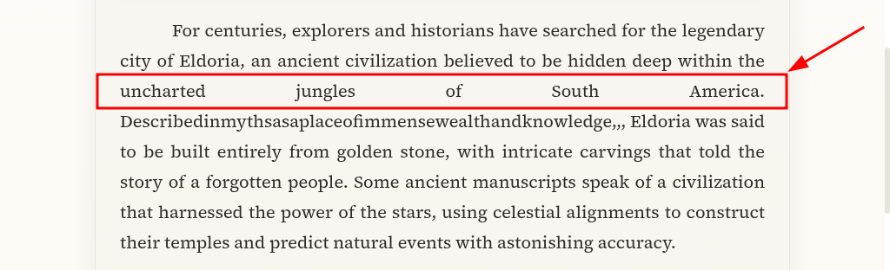

### Severity:
Low

### Priority:
Low

-------------------

## BUG-002: Image not showing below the second paragraph

- **Related Test Case:** TC-004

### Steps:
1. Open the article page.
2. Scroll down to the second paragraph.

### Expected:
The image shows.

### Actual:
- The image is not displayed; a broken-image icon with the alt text is shown instead.
- The request `GET /assets/images/article-eldoria-1.webp` returns **404 (Not Found)**.

### Visual Evidence:
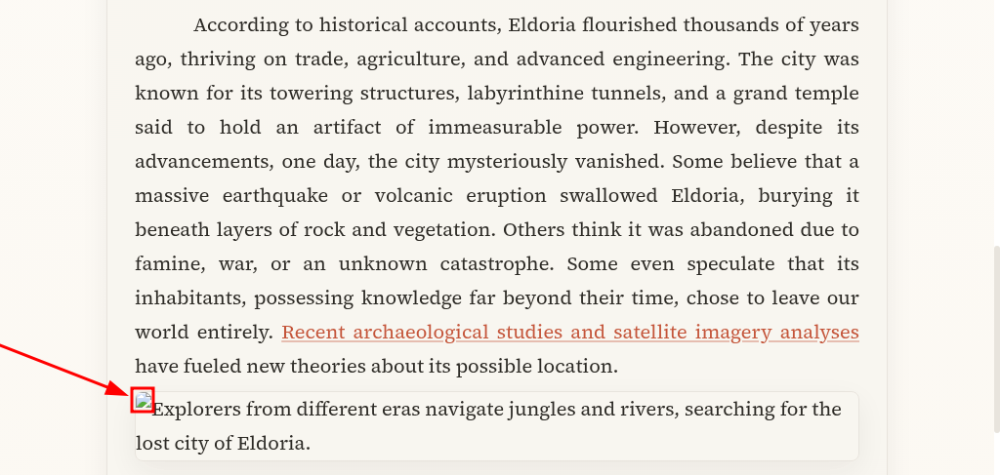

### Technical Context:
* DevTools Elements:
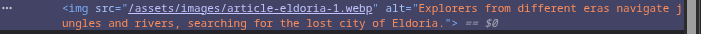

* DevTools Console logs:
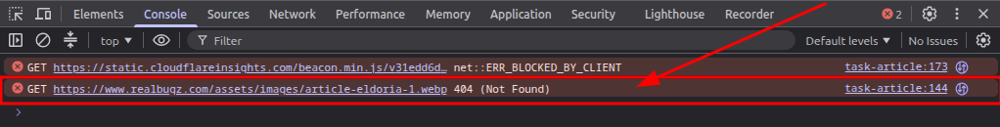

* DevTools Network logs:
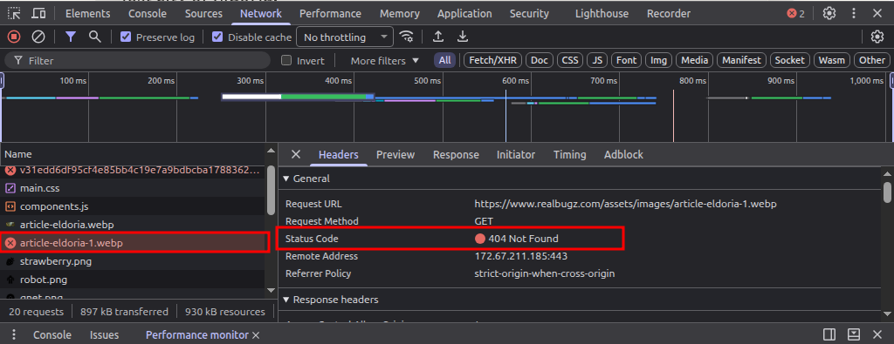

### Severity:
Medium

### Priority:
Medium

-------------------

## BUG-003: Archaeological Studies page returns 404 error

- **Related Test Case:** TC-001

### Steps:
- Open the "**Archaeological Studies**" page through the link in the Article page, or directly through this link [https://www.realbugz.com/en/archaeological-studies.html](https://www.realbugz.com/en/archaeological-studies.html).

### Expected:
A working page containing an article.

### Actual:
Broken page showing Status Code: 404 Not Found.

### Visual Evidence:
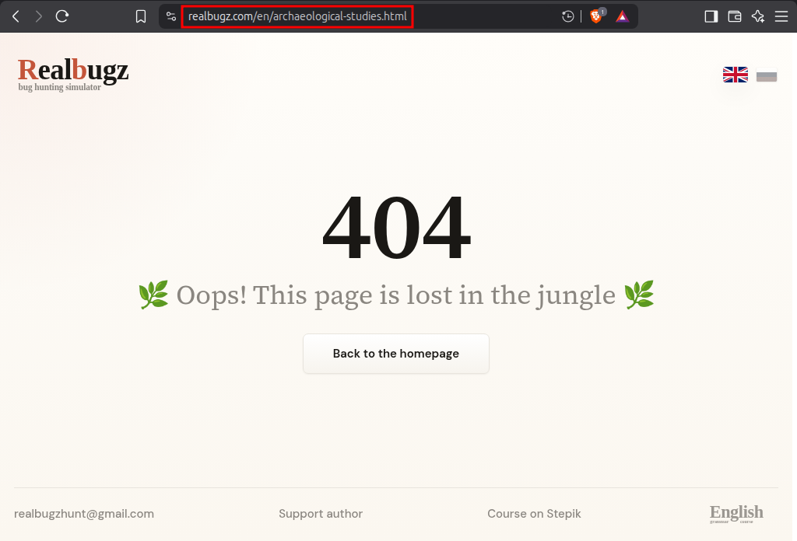

### Technical Context:
* DevTools Console Logs:
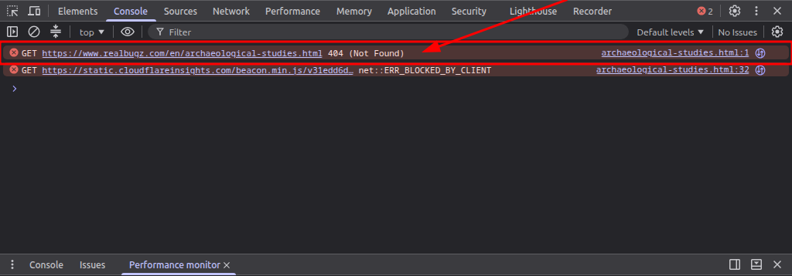

* DevTools Network Logs:
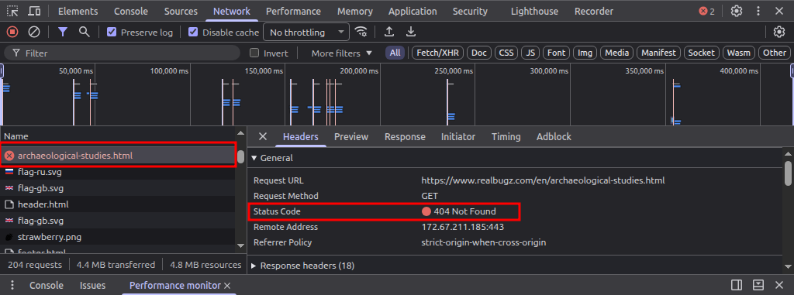

### Severity:
High

### Priority:
High

-----------------------

## BUG-004: Ineffective Share Buttons

- **Related Test Case:** TC-002

### Steps:
1. Scroll to the very end of the page till you see the "**Share this article**" phrase, and the three share buttons.
2. Click on the share buttons.

### Expected:
The user will be able to share the article on their social media accounts.

### Actual:
The three buttons are not effective, no action is triggered.

### Visual Evidence:
<video controls src="videos/uneffective_share_buttons1.mp4" title="Title"></video>
https://github.com/MustafaXWolf/QA-Portfolio/blob/main/Project1/videos/uneffective_share_buttons1.mp4

### Technical Context:
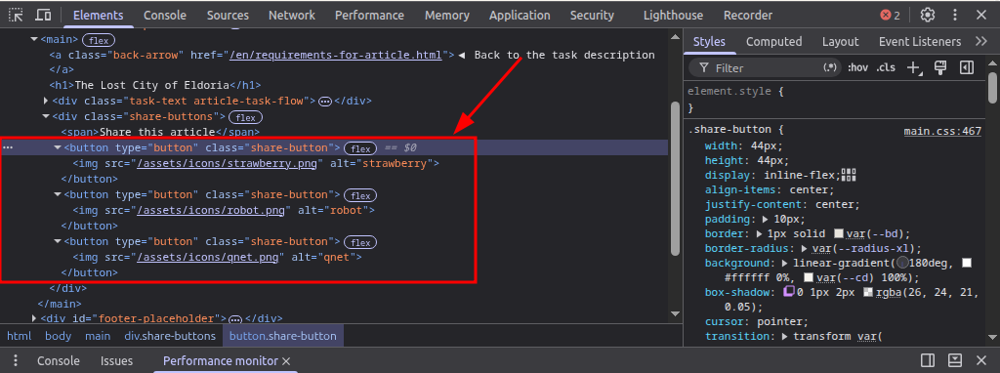

### Severity:
Medium

### Priority:
Medium

-------------------

## BUG-005: Cloudflare Insights analytics script blocked in the console (ERR_BLOCKED_BY_CLIENT)

- **Related Test Case:** TC-005

### Steps:
1. Open the article page.
2. Open the DevTools.
3. Go to the Console tab and reload the page.
4. Notice the failed GET request shown in the images below.

### Expected:
No failed requests appear in the console on page load.

### Actual:
- The console shows `GET https://static.cloudflareinsights.com/beacon.min.js/... net::ERR_BLOCKED_BY_CLIENT`.
- The request comes from a `<script type="module">` tag at line 173 of the page source (the Cloudflare Web Analytics beacon).

### Notes:
`ERR_BLOCKED_BY_CLIENT` means the request was blocked inside the browser (most likely by Brave Shields or an ad blocker), not rejected by the server. It should be re-tested with Shields disabled to confirm whether it is a site defect. It is reported as a low-impact observation.

### Visual Evidence and Technical Context:
* DevTools Console Logs:
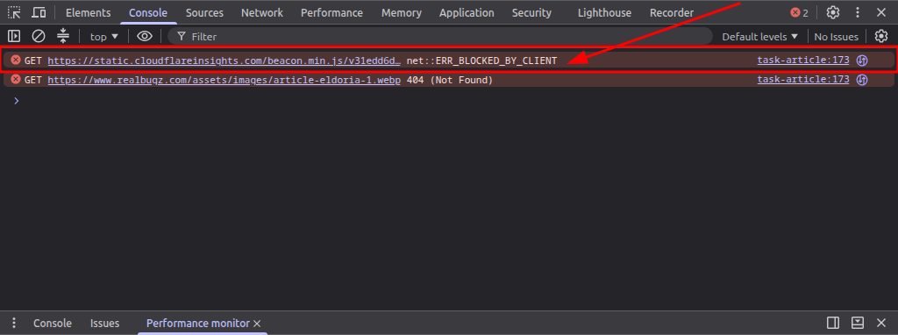

* DevTools Network Logs:
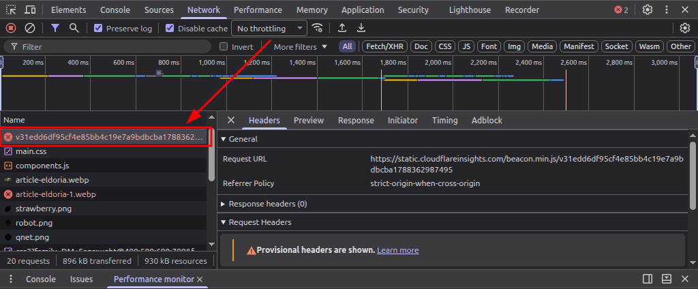

* DevTools Sources:
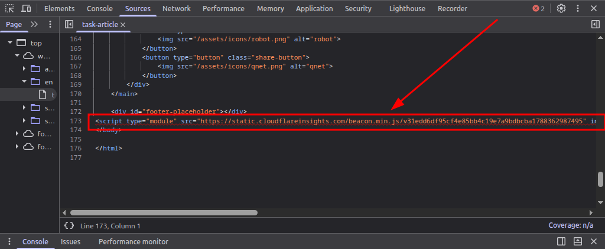

### Severity:
Low

### Priority:
Low
