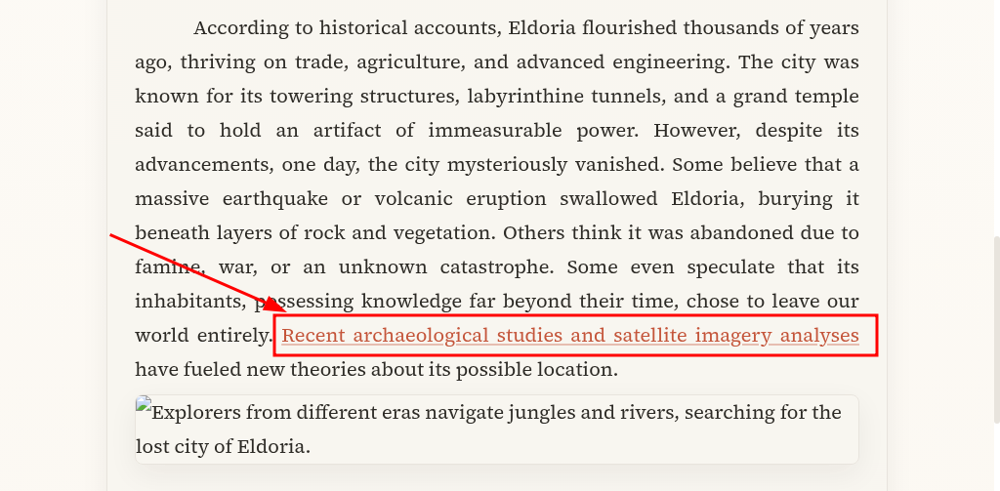
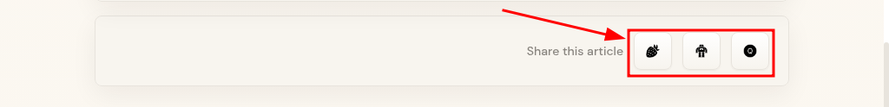

# Test Cases – Realbugz "Article" Page

| Total | Passed ✔ | Failed ✘ |
|:-----:|:--------:|:--------:|
| 5 | 0 | 5 |

---

## TC-001: Verify link navigation works correctly

### Steps:
1. Scroll down to the second paragraph until you reach the "**Recent archaeological studies and satellite imagery analyses**" link.
2. Click on the link.

### Expected:
User is redirected to the Archaeological Studies page successfully (HTTP 200, content loads correctly).

### Actual Result:
The user is redirected to a page that returns **404 Not Found**.

### Status:
- Fail ✘

### Related Bug:
- BUG-003

---

## TC-002: Clickable and effective buttons

### Steps:
1. Scroll to the very end of the page until you see the "**Share this article**" phrase and the three share buttons.
2. Click on the share buttons.

### Expected:
The user is able to share the article on their social media accounts.

### Actual Result:
None of the three buttons triggers any action.

### Status:
- Fail ✘

### Related Bug:
- BUG-004

---

## TC-003: Verify the article text is readable and correctly formatted

### Steps:
1. Open the article page.
2. Scroll down to the first paragraph.
3. Read every line and check the word spacing, the spaces between words, and the punctuation.

### Expected:
- Lines are evenly spaced.
- Words are separated by single spaces.
- Punctuation is correct (no repeated commas).

### Actual Result:
- The third line is stretched with wide gaps between words.
- The fourth line starts with merged words and repeated commas.

### Status:
- Fail ✘

### Related Bug:
- BUG-001

---

## TC-004: Verify the article image loads correctly

### Steps:
1. Open the article page.
2. Scroll down to the image below the second paragraph.
3. Check that the image is displayed.
4. If it is not, open DevTools (Network tab) and check the status code of the image request.

### Expected:
The image is displayed and its request returns HTTP 200.

### Actual Result:
A broken-image icon with the alt text is shown. The image request returns **404 Not Found**.

### Status:
- Fail ✘

### Related Bug:
- BUG-002

---

## TC-005: Verify there are no errors in the browser console on page load

### Steps:
1. Open the article page.
2. Open DevTools and go to the Console tab.
3. Reload the page and review the messages.

### Expected:
No errors or failed requests appear in the console.

### Actual Result:
Two errors appear:
- `404 (Not Found)` for `article-eldoria-1.webp` (see BUG-002).
- `net::ERR_BLOCKED_BY_CLIENT` for the Cloudflare Insights script (see BUG-005).

### Status:
- Fail ✘

### Related Bugs:
- BUG-002
- BUG-005
