# Bug Reports – Realbugz "Registration Form"

**Environment (all bugs):** Linux Mint (XFCE) · Brave 1.93.138 · Desktop. See the [test plan](./test-plan.md).

## Summary

| ID | Title | Related TC | Severity | Priority | Status |
|----|-------|:----------:|:--------:|:--------:|:------:|
| BUG-001 | Three required fields missing the asterisk (*) | TC-001 | Low | Low | Open |
| BUG-002 | Form submits with "Preferred Role" blank (missing `required`) | TC-002 & TC-010 | High | High | Open |
| BUG-003 | Form submits after required fields are deleted in DevTools | TC-002 | High | High | Open |
| BUG-004 | "Terms and Conditions" tooltip does not appear | TC-003 | Medium | Medium | Open |
| BUG-005 | Form not cleared after successful submission | TC-004 | Low | Low | Open |
| BUG-006 | No error message next to the invalid field | TC-004 | Medium | Medium | Open |
| BUG-007 | No success message after "Clear Form" | TC-004 | Low | Low | Open |
| BUG-008 | Full Name accepts invalid length and characters | TC-005 | Medium | Medium | Open |
| BUG-009 | Email accepts missing TLD and over 100 characters | TC-006 | Medium | Medium | Open |
| BUG-010 | Date of Birth accepts ages under 18 and over 70 | TC-008 | Medium | Medium | Open |
| BUG-011 | Empty option accepted in "Archaeology Experience" | TC-009 | High | High | Open |
| BUG-012 | Unlisted roles accepted in "Preferred Role" | TC-010 | High | High | Open |
| BUG-013 | Unlisted regions and multi-select accepted in "Preferred Region" | TC-011 | High | High | Open |
| BUG-014 | Slider min / increment wrong; tampered min / max accepted | TC-012 | High | Medium | Open |
| BUG-015 | Wrong contact options; tampered values accepted | TC-013 | High | Medium | Open |
| BUG-016 | Passport/ID accepts wrong formats and files over 5 MB | TC-014 | High | High | Open |
| BUG-017 | Comments accepts more than 1000 characters | TC-015 | Medium | Low | Open |
| BUG-018 | Form submits after `required` attribute is removed | TC-017 | High | High | Open |

---

## BUG-001: Some required fields are not marked with an asterisk (*)

- **Related Test Case:** TC-001

### Steps:
1. Open the form page.
2. Scroll down and take a look at these fields "**Archaeology Experience, Preferred Role in the Expedition, Preferred Expedition Region**".

### Expected:
The three fields have an asterisk (*) next to their titles.

### Actual:
The three fields are not marked with the asterisk (*) sign.

### Visual Evidence:
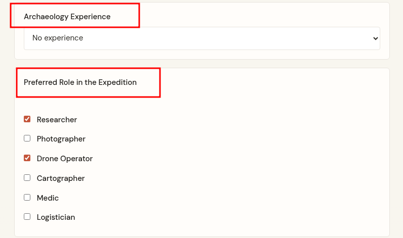

### Severity:
Low

### Priority:
Low

---------------------------------

## BUG-002: The form can be submitted while "Preferred Role in the Expedition" required field left blank (html code missing the "required" tag)

- **Related Test Cases:** TC-002 & TC-010

### Steps:
1. Open the form page.
2. Fill every required field except "**Preferred Role in the Expedition**" field.
3. Submit the form.

### Expected:
The form can not be submitted, and an error message should appear next to the field.

### Actual:
- The form can actually be submitted successfully without any error message appearing next to the field.
- The html code missing the "**required tag**".

### Visual Evidence:
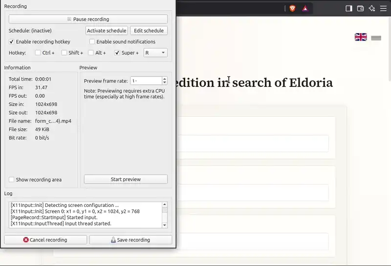

[Full-quality MP4](videos/form_can_be_submitted_while_field_blank1.mp4)

### Technical Context:
* DevTools Elements:
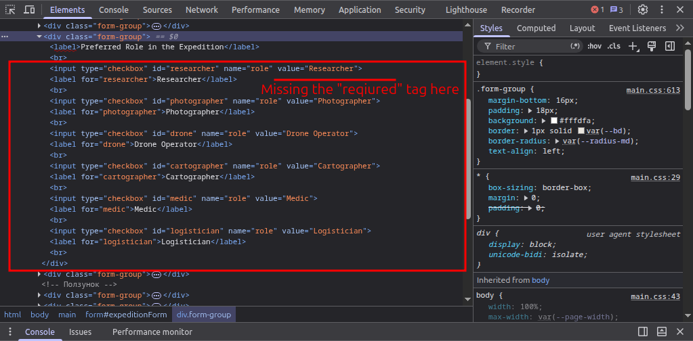

### Severity:
High

### Priority:
High

---------------------------------

## BUG-003: The form can be submitted while the required fields are deleted by DevTools Elements

- **Type: Client-side validation bypass**
- **Related Test Case:** TC-002

### Steps:
1. Open the form page.
2. Open the DevTools Elements.
3. Delete the code for the required fields.

### Expected:
The form can not be submitted, and an error message should appear.

### Actual:
The form can actually be submitted successfully without any error message appearing anywhere.

### Visual Evidence:
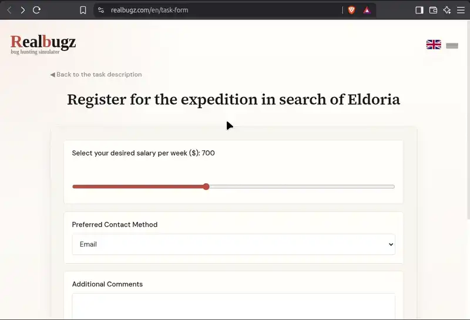

[Full-quality MP4](videos/deleted_fields1.mp4)

### Technical Context:
* DevTools Elements:
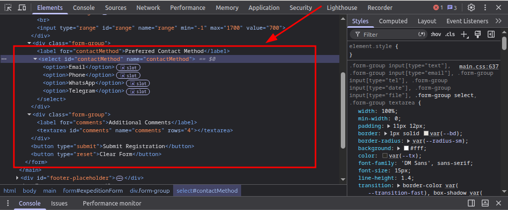

### Severity:
High

### Priority:
High

---------------------------------

## BUG-004: The words "Terms and Conditions" are not interactive

- **Related Test Case:** TC-003

### Steps:
1. Open the form page.
2. Scroll down to the very end of the page till you see the phrase "**I Agree to Terms and Conditions**".
3. Try hovering over the words "**Terms and Conditions**".

### Expected:
Hovering over them should display a tooltip explaining how the user's submitted data will be used.

### Actual:
Nothing is displayed no matter how long the hovering lasts.

### Visual Evidence:
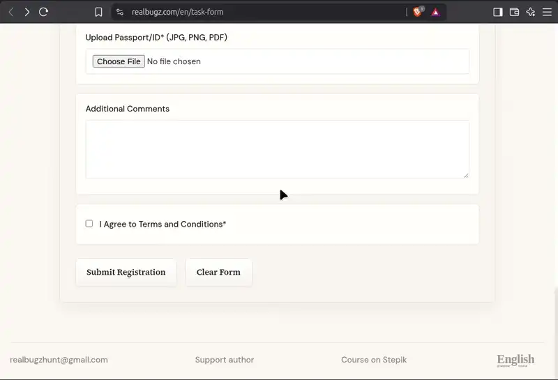

[Full-quality MP4](videos/hovering_not_working1.mp4)

### Severity:
Medium

### Priority:
Medium

---------------------------------

## BUG-005: Clicking the "Submit Registration" button does not automatically clear the form after it has been successfully submitted

- **Related Test Case:** TC-004

### Steps:
1. Open the form page.
2. Fill the form "at least the required fields".
3. Scroll down to the very end of the page till you see the "**Submit Registration**" button.
4. Click on it.

### Expected:
- The form has been successfully submitted.
- A success message should be displayed.
- The form fields should be automatically cleared.

### Actual:
- The form was submitted successfully.
- A success message was displayed.
- The form fields were not automatically cleared.

### Visual Evidence:
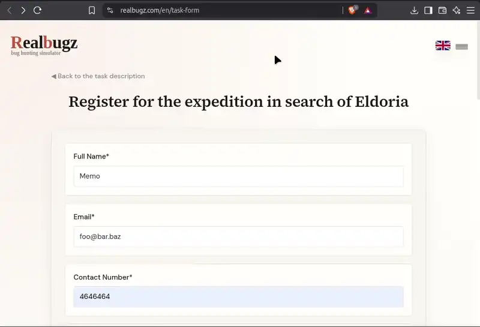

[Full-quality MP4](videos/submit_button_not_clearing1.mp4)

### Severity:
Low

### Priority:
Low

---------------------------------

## BUG-006: When clicking the "Submit Registration" button, no error message appears next to the field where the error occurred

- **Related Test Case:** TC-004

### Steps:
1. Open the form page.
2. Leave any required field blank.
3. Try submitting the form.

### Expected:
- The form is not being submitted successfully.
- An error message should appear next to the field where the error occurred.

### Actual:
- The form is not being submitted successfully.
- The field where the error occurred is being identified, but no error message has occurred.

### Visual Evidence:
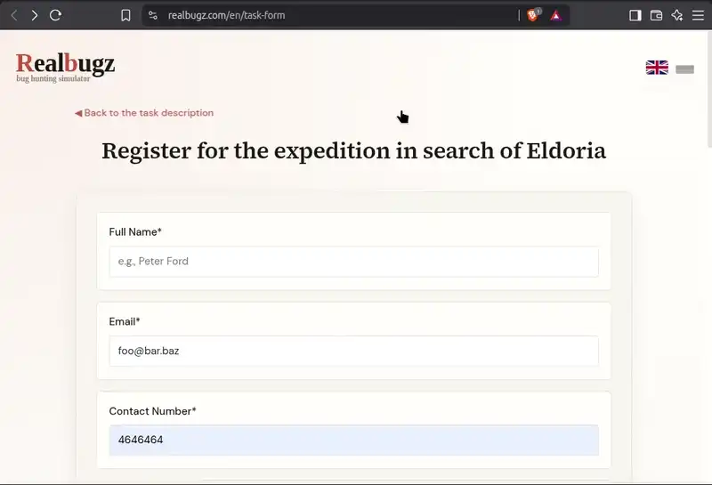

[Full-quality MP4](videos/no_error_message1.mp4)

### Severity:
Medium

### Priority:
Medium

---------------------------------

## BUG-007: Clicking the "Clear Form" button does not display a success message after clearing the form data

- **Related Test Case:** TC-004

### Steps:
1. Open the form page.
2. Fill the form fields "even one or two".
3. Scroll down to the very end of the page till you see the "**Clear Form**" button.
4. Click on it.

### Expected:
- The form data should be successfully cleared.
- A success message should be displayed after clearing the form data.

### Actual:
- The form data has been successfully cleared.
- No success message has occurred.

### Visual Evidence:
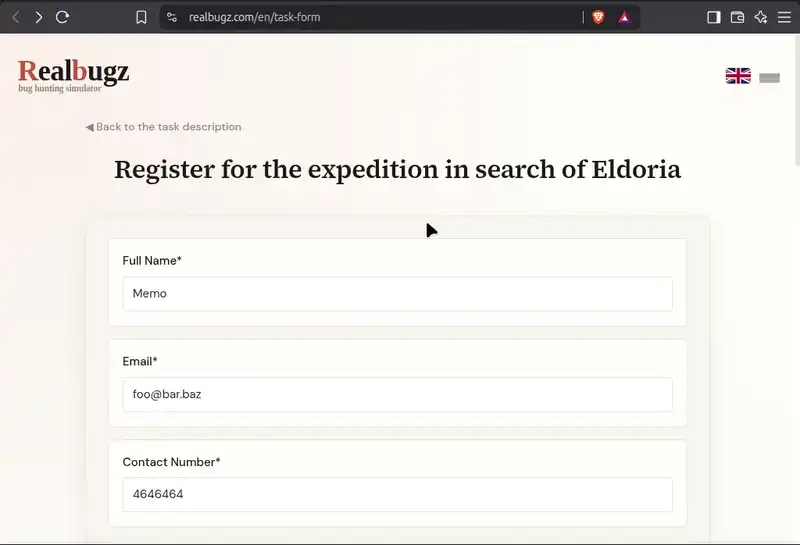

[Full-quality MP4](videos/no_clear_success_message1.mp4)

### Severity:
Low

### Priority:
Low

---------------------------------

## BUG-008: Full Name field accepts invalid input (length and character restrictions ignored)

- **Related Test Case:** TC-005

### Steps:
1. Open the form page.
2. Try filling out the field with **one character**, then try submitting the form after filling out the other fields correctly.
3. Try filling out the field with **more than 50 characters**, then try submitting the form after filling out the other fields correctly.
4. Try **using digits and special characters like (*&^%$#@!?, etc...)** to fill out the field, then try submitting the form after filling out the other fields correctly.

### Expected:
- The form cannot be submitted after filling out the field with only one character.
- The form cannot be submitted after filling out the field with more than 50 characters.
- The form cannot be submitted after filling out the field using digits and special characters like (*&^%$#@!?, etc...).

### Actual:
- The form can actually be submitted after filling out the field with only one character.
- The form can actually be submitted after filling out the field with more than 50 characters.
- The form can actually be submitted after filling out the field using digits and special characters like (*&^%$#@!?, etc...).

### Visual Evidence:
- Submitting with one character:
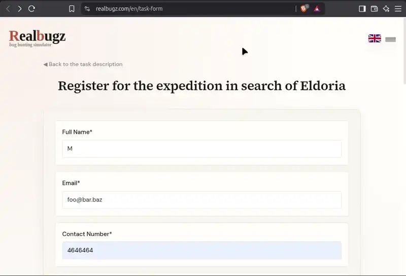

[Full-quality MP4](videos/one_character1.mp4)

* Submitting with more than 50 characters:
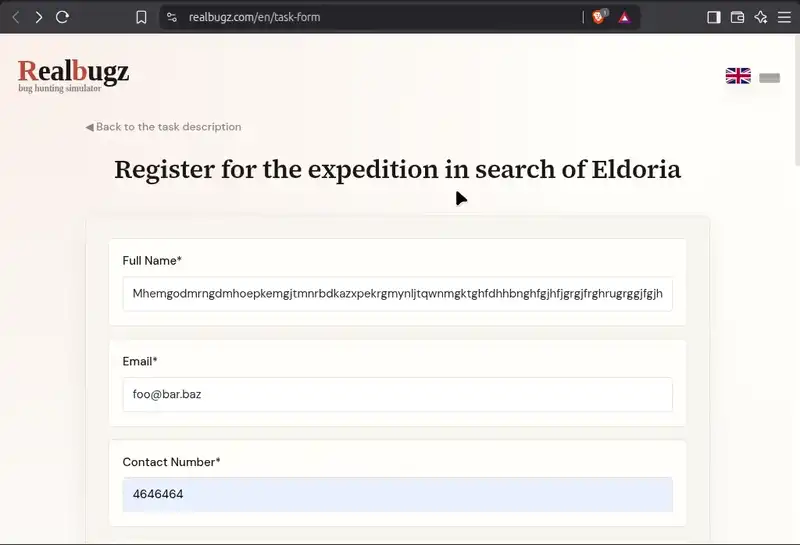

[Full-quality MP4](videos/more_than_50_characters1.mp4)

- Submitting with digits and special characters:
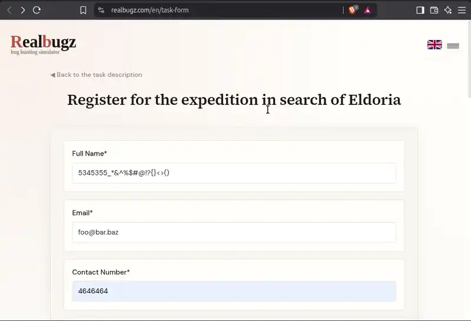

[Full-quality MP4](videos/digits_and_special_characters1.mp4)

### Severity:
Medium

### Priority:
Medium

---------------------------------

## BUG-009: Email field accepts invalid input (invalid address without top-level domain, and invalid length)

- **Related Test Case:** TC-006

### Steps:
1. Open the form page.
2. Try filling out the field using invalid address without top-level domain, for instance "**foo@bar**" or "**test@gmail**".
   - Try submitting the form after filling out the other fields correctly.
3. Try filling out the field with more than **100 characters**, then try submitting the form after filling out the other fields correctly.

### Expected:
- The form cannot be submitted after filling out the field with the wrong email format.
- The form cannot be submitted after filling out the field with more than 100 characters.

### Actual:
- The form can actually be submitted after filling out the field with the wrong email format.
- The form can actually be submitted after filling out the field with more than 100 characters.

### Visual Evidence:
- Submitting with wrong format:
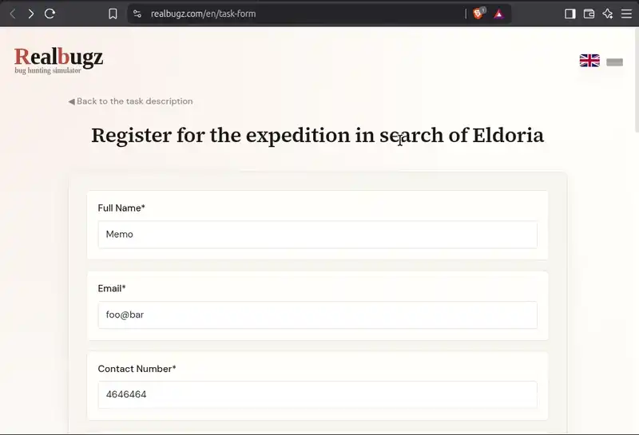

[Full-quality MP4](videos/wrong_email_format1.mp4)

* Submitting with more than 100 characters:
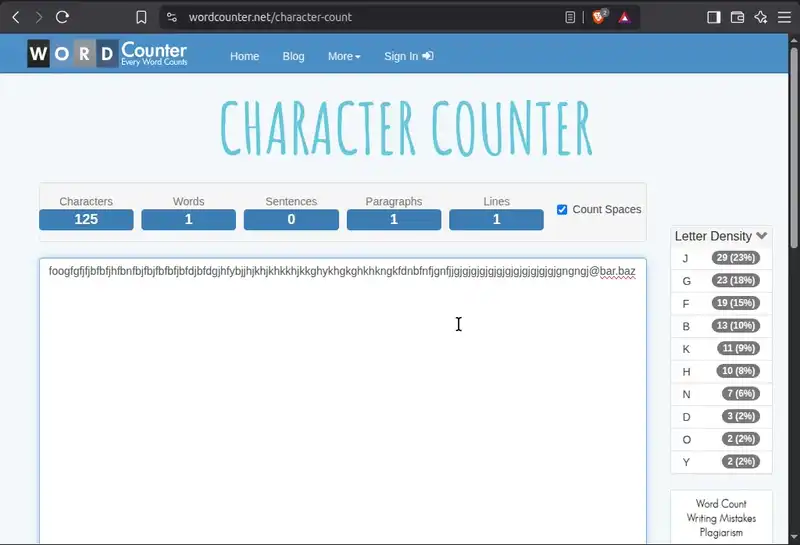

[Full-quality MP4](videos/wrong_email_length1.mp4)

### Severity:
Medium

### Priority:
Medium

---------------------------------

## BUG-010: Date of Birth field accepts invalid age limits

- **Related Test Case:** TC-008

### Steps:
1. Open the form page.
2. Try filling out the field with an old date of birth, indicating an age over 70.
   - Try submitting the form after filling out the other fields correctly.
3. Try filling out the field with a date of birth indicating an age under 18.
   - Try submitting the form after filling out the other fields correctly.

### Expected:
- The form cannot be submitted after filling out the field with an old date of birth, indicating an age over 70.
- The form cannot be submitted filling out the field with a date of birth indicating an age under 18.

### Actual:
- The form can actually be submitted after filling out the field with an old date of birth, indicating an age over 70.
- The form can actually be submitted filling out the field with a date of birth indicating an age under 18.

### Visual Evidence:
- Submitting using an age over 70:
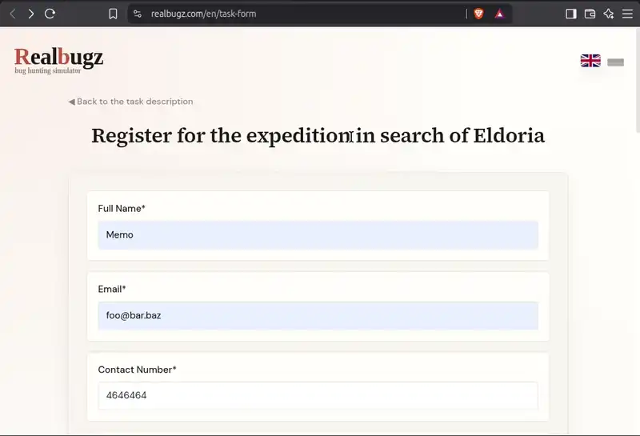

[Full-quality MP4](videos/age_over_70_1.mp4)

* Submitting using an age under 18:
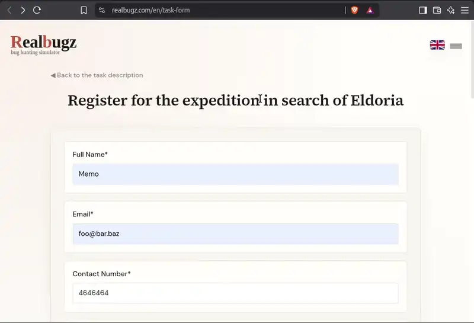

[Full-quality MP4](videos/age_under_18_1.mp4)

### Severity:
Medium

### Priority:
Medium

---------------------------------

## BUG-011: The form can be submitted after using the DevTools Elements to make the "Archaeology Experience" field blank

- **Type: Client-side validation bypass**
- **Related Test Case:** TC-009

### Steps:
1. Open the form page.
2. Open the DevTools Elements.
3. Try adding a new line of code to the dropdown list options.
4. Make the option empty like the one here 
```<option></option>```.
5. Try submitting the form after filling out the other fields correctly.

### Expected:
- The form cannot be submitted after editing the html code, and an error message should appear next to the field.

### Actual:
- The form can actually be submitted after editing the html code, and no error message appeared next to the field.

### Visual Evidence:
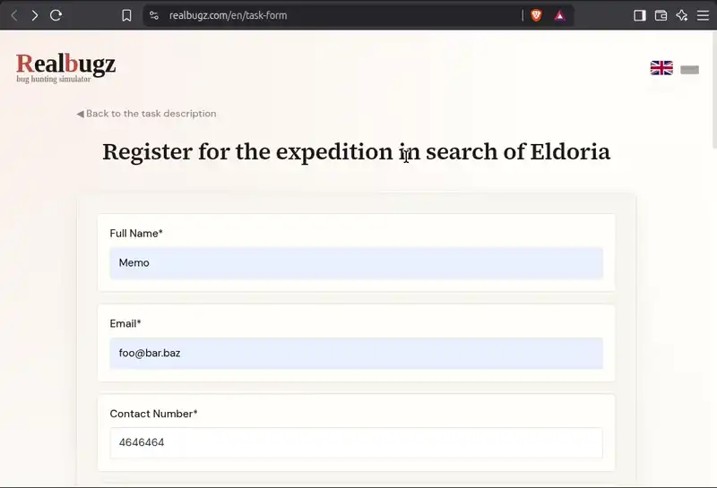

[Full-quality MP4](videos/experience_field_empty1.mp4)

### Technical Context:
* DevTools Elements:
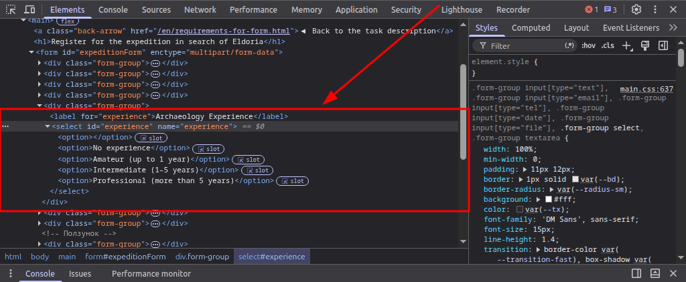

### Severity:
High

### Priority:
High

---------------------------------

## BUG-012: The form can be submitted after using the DevTools Elements to add new role options to the "Preferred Role in the Expedition" field or to replace an existing option

- **Type: Client-side validation bypass**
- **Related Test Case:** TC-010

### Steps:
1. Open the form page.
2. Open the DevTools Elements.
3. Try to add a new snippet of code to the field section in the html code using the Elements tool, for instance:
```<input type="checkbox" id="Musician" name="role" value="Musician">```
```<label for="Musician">Musician</label><br>```
4. Try replacing an existing option with a new one, for instance, I replaced the Medic with Footballer.
5. Try submitting the form after filling out the other fields correctly.

### Expected:
- The form cannot be submitted after editing the html code, and an error message should appear next to the field.

### Actual:
- The form can actually be submitted after editing the html code, and no error message appeared next to the field.

### Visual Evidence:
- The field after modification:
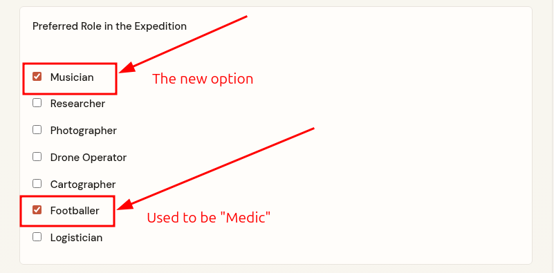

* The submitting process:
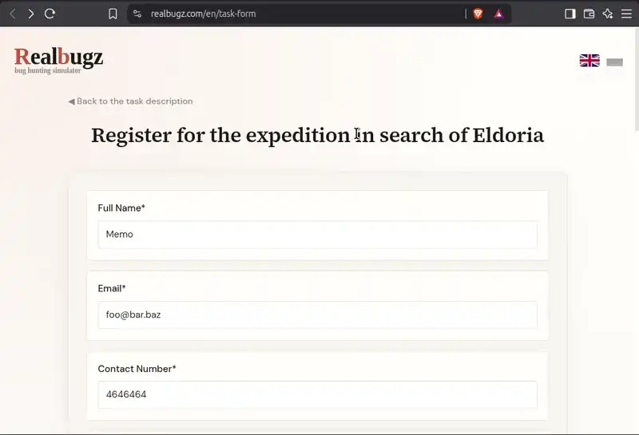

[Full-quality MP4](videos/new_roles_options1.mp4)

### Technical Context:
- DevTools Elements:
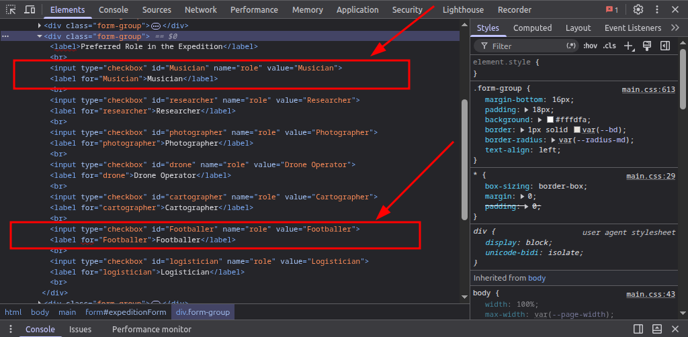

### Severity:
High

### Priority:
High

---------------------------------

## BUG-013: The form can be submitted after using the DevTools Elements to add new region options to the "Preferred Expedition Region" field, or to replace an existing option, or to make multiple selections allowed

- **Type: Client-side validation bypass**
- **Related Test Case:** TC-011

### Steps:
1. Open the form page.
2. Open the DevTools Elements in your browser.
3. Try to add a new option by adding a new snippet of code to the field section in the html code using the Elements tool, for instance:
```<input type="radio" name="region" id="antarctica" value="Antarctica">```
```<label for="antarctica">Antarctica</label><br>```
4. Try replacing an existing option with a new one, for instance, I replaced Asia with Canada.
5. Try editing the code to make multiple selections allowed by changing the input type from "radio" to "checkbox", for instance: ```type="checkbox"```
6. Try submitting the form after filling out the other fields correctly.

### Expected:
- The form cannot be submitted after editing the html code, and an error message should appear next to the field.

### Actual:
- The form can actually be submitted after editing the html code, and no error message appeared next to the field.

### Visual Evidence:
- The field after adding and replacing the options:
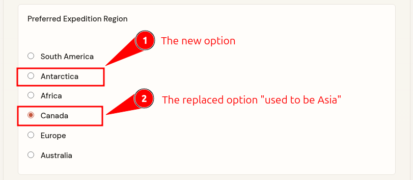

* The submitting process after adding and replacing the options:
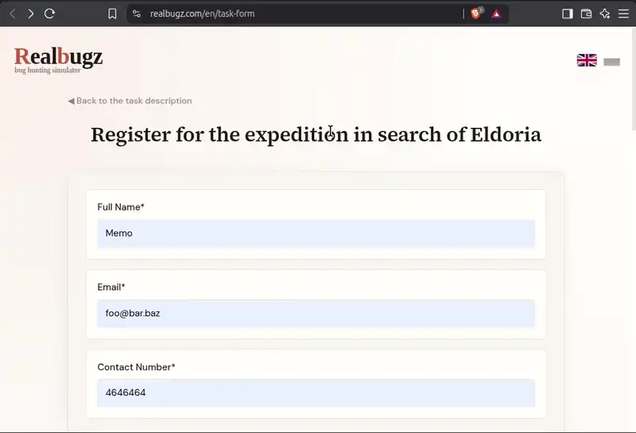

[Full-quality MP4](videos/new_region_options1.mp4)

- The field after making multiple selections allowed:
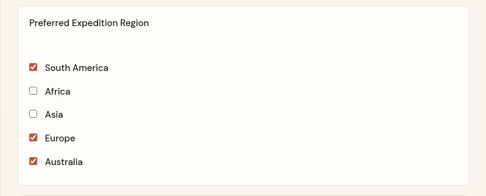

* The submitting process after making multiple selections allowed:
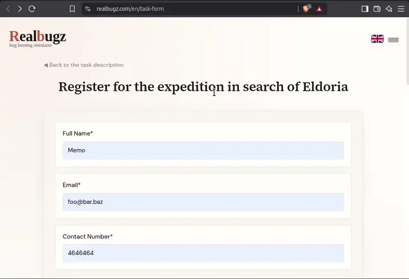

[Full-quality MP4](videos/region_multiple_selections1.mp4)

### Technical Context:
- The html code after adding and replacing the options:
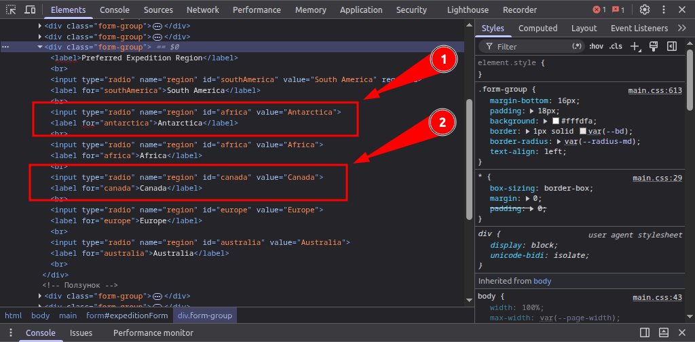

* The html code after making multiple selections allowed:
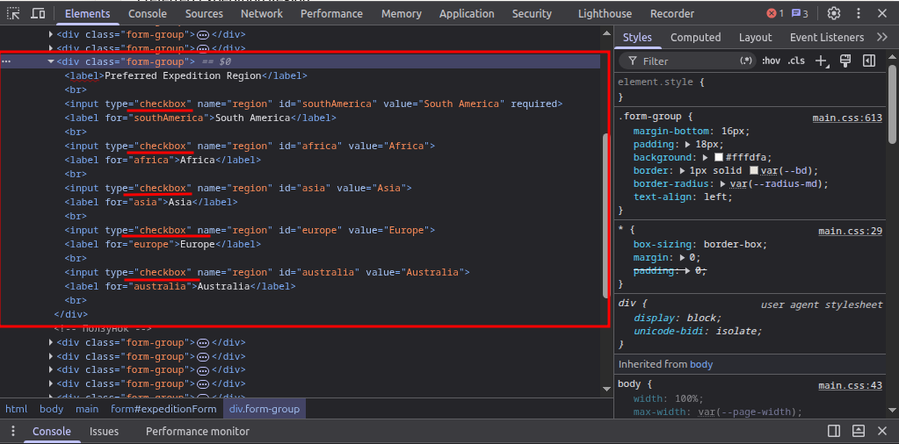

### Severity:
High

### Priority:
High

---------------------------------

## BUG-014: Minimum value and Increment step in "Select your desired salary per week ($)" field are faulty, and the form can be submitted after changing the Minimum and Maximum values by editing the html code using DevTools Elements

- **Type: Client-side validation bypass**
- **Related Test Case:** TC-012

### Steps:
1. Open the form page.
2. Check whether the values ​​are correct.
3. Try moving the slider to the right and left.
   - Watch its increment steps.
4. Open the DevTools Elements in your browser.
   - Try changing the slider maximum and minimum values by changing the min and max values in the input line in the field section in the html code, for instance:
   ```min="500" max="5000"```
5. Try submitting the form after filling out the other fields correctly.

### Expected:
- The form cannot be submitted after editing the html code, and an error message should appear next to the field.

### Actual:
- The form can actually be submitted after editing the html code, and no error message appeared next to the field.

### Visual Evidence:
- The slider's wrong minimum value:
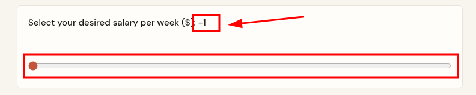

* The slider's faulty increment step:


[Full-quality MP4](videos/slider_faulted_increment _step1.mp4)

- The submitting process after changing the Maximum and Minimum values:
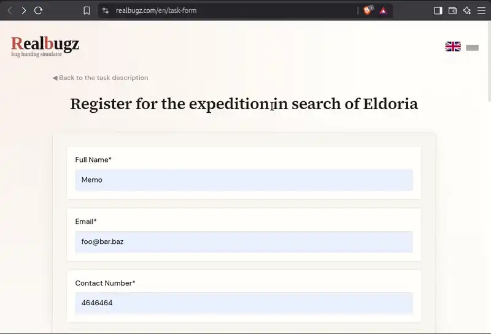

[Full-quality MP4](videos/slider_new_values1.mp4)

### Technical Context:
- The wrong Minimum value in the html code:
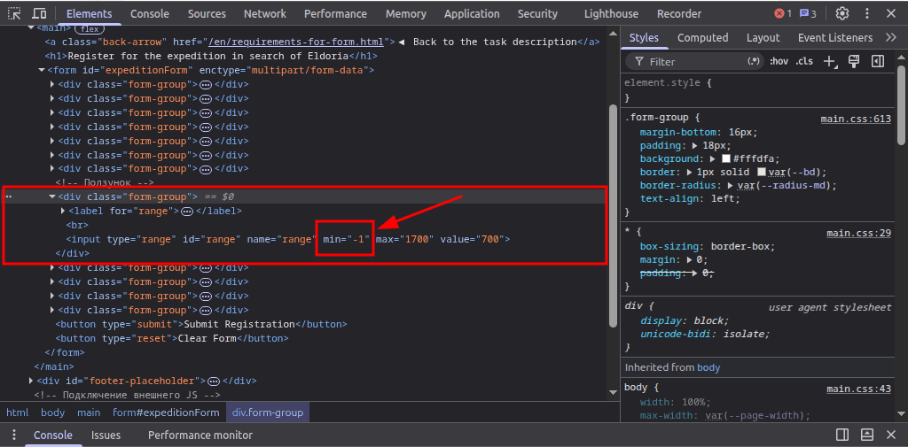

* The html code after changing the Maximum and Minimum values:
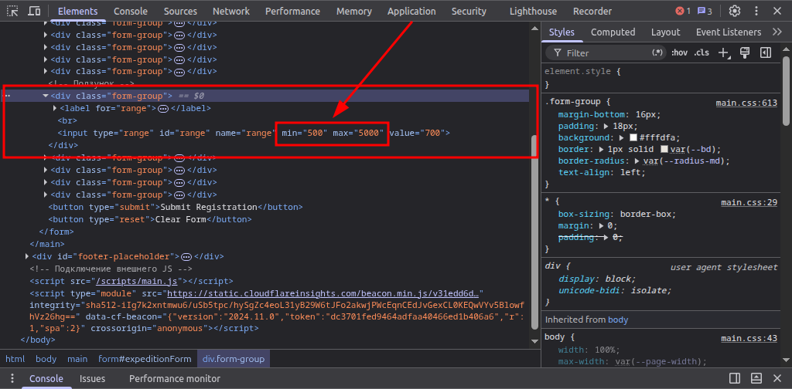

### Severity:
High

### Priority:
Medium

### Priority Rationale:
The slider is an optional field and the bypass requires manual DevTools tampering, so the fix is less urgent than the bypasses on required fields.

---------------------------------

## BUG-015: Wrong contact options values in the "Preferred Contact Method" field, and the form can be submitted after using the DevTools Elements to add new contact method options to the field, or to replace an existing option, or to make multiple selections allowed

- **Type: Client-side validation bypass**
- **Related Test Case:** TC-013

### Steps:
1. Open the form page.
2. Open the DevTools Elements in your browser.
3. Try to add a new option by adding a new snippet of code to the field section in the html code using the Elements tool, for instance:
```<option>Pigeon</option>```
4. Try replacing an existing option with a new one, for instance, I replaced Email with Messenger.
5. Try editing the code to make multiple selections allowed by changing the input type from being a raw options list to be a "checkbox" list, for instance: ```type="checkbox"```
6. Try submitting the form after filling out the other fields correctly.

### Expected:
- The form cannot be submitted after editing the html code, and an error message should appear next to the field.

### Actual:
- The form can actually be submitted after editing the html code, and no error message appeared next to the field.

### Visual Evidence:
- The submitting process after adding and replacing the options:


[Full-quality MP4](videos/new_contact_values1.mp4)

* The submitting process after making multiple selections allowed:
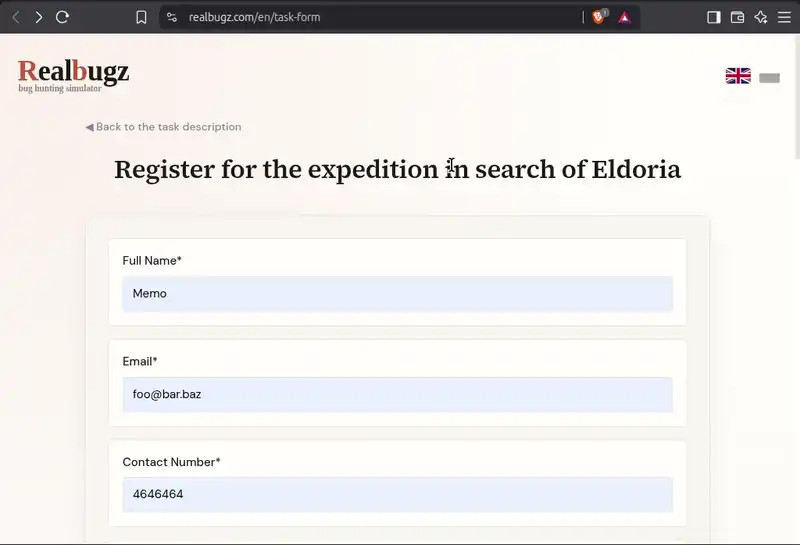

[Full-quality MP4](videos/contact_multiple_selections1.mp4)

### Technical Context:
* Wrong contact option value:
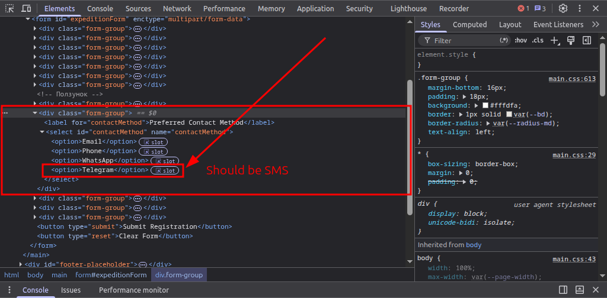

- The html code after adding and replacing the options:
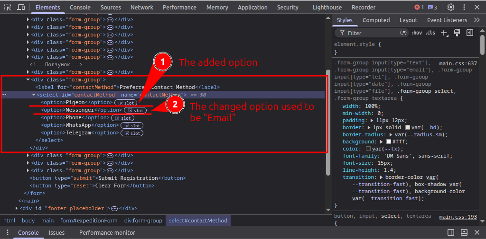

* The html code after making multiple selections allowed:
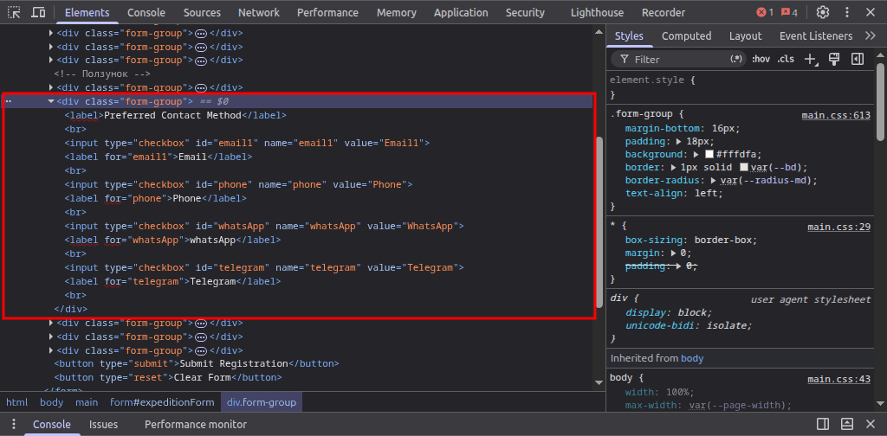

### Severity:
High

### Priority:
Medium

### Priority Rationale:
The contact method is an optional field and the bypass requires manual DevTools tampering, so the fix is less urgent than the bypasses on required fields.

---------------------------------

## BUG-016: "Upload Passport/ID" field accepts wrong formats and wrong size

- **Related Test Case:** TC-014

### Steps:
1. Open the form page.
2. Scroll down to the "**Upload Passport/ID**" field.
3. Try uploading wrong file format not included here "JPG, PNG, PDF".
4. Try uploading wrong size file that sizes more than 5 MB.
5. Try submitting the form after filling out the other fields correctly.
6. Editing the HTML through DevTools Elements is not necessary in this case, because the field's code is already faulty (see Technical Context).

### Expected:
- The form cannot be submitted, and an error message should appear next to the field.

### Actual:
- The form can actually be submitted with a wrong file format and with a file larger than 5 MB, and no error message appeared next to the field.

### Visual Evidence:
- The submitting process using wrong format and size:
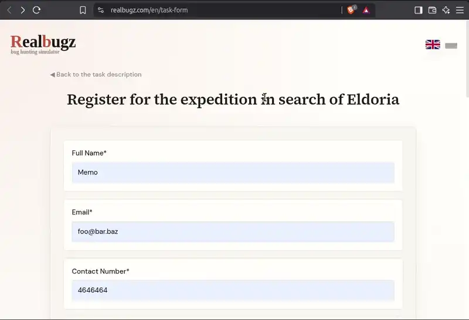

[Full-quality MP4](videos/id_wrong_format_and_size1.mp4)

### Technical Context:
* The html code showing that the form can accepts wrong formats:
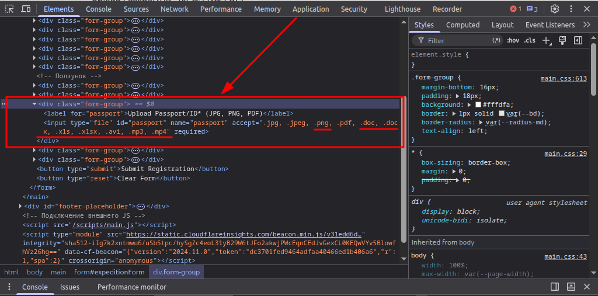

### Severity:
High

### Priority:
High

---------------------------------

## BUG-017: "Additional Comments" field accepts wrong Maximum length more than 1000 characters

- **Related Test Case:** TC-015

### Steps:
1. Open the form page.
2. Scroll down to the "**Additional Comments**" field.
3. Try entering more than 1000 characters.
4. Try submitting the form after filling out the other fields correctly.

### Expected:
- The form cannot be submitted, and an error message should appear next to the field.

### Actual:
- The form can actually be submitted, and no error message appeared next to the field.

### Visual Evidence:
- The submitting process using wrong Maximum length more than 1000 characters:
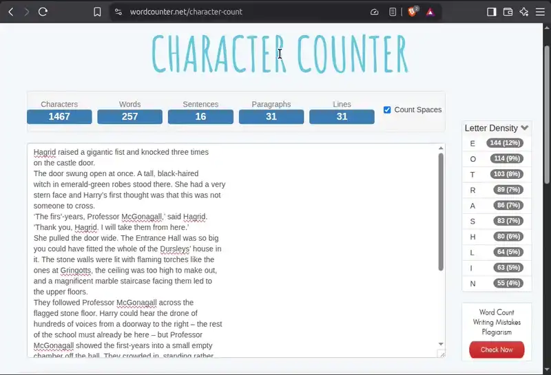

[Full-quality MP4](videos/comments_wrong_length1.mp4)

### Severity:
Medium

### Priority:
Low

### Priority Rationale:
Additional Comments is an optional free-text field with low user impact, so the fix can follow the more critical validation issues.

---------------------------------

## BUG-018: The form can be submitted without filling out the required fields after deleting the "required" tag from the html code for those fields using the DevTools Elements

- **Type: Client-side validation bypass**
- **Related Test Case:** TC-017

### Steps:
1. Open the form page.
2. Open the DevTools in your browser.
3. Go to the Elements section.
4. Delete the "**required**" tag from the required fields code, you'll find it in the ```<input>``` line.
5. Try submitting the form.

### Expected:
- The form cannot be submitted, and an error message should appear next to those fields.

### Actual:
- The form can actually be submitted, and no error message appeared next to any field.

### Visual Evidence:
- The submitting process after deleting the required tag and not filling out any required fields:
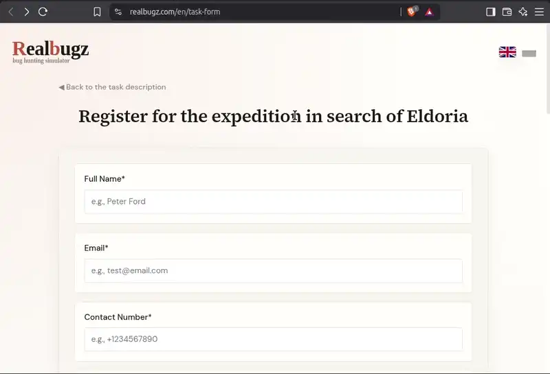

[Full-quality MP4](videos/deleted_required_tag1.mp4)

### Technical Context:
* The html code from DevTools Elements after deleting the "required" tag:
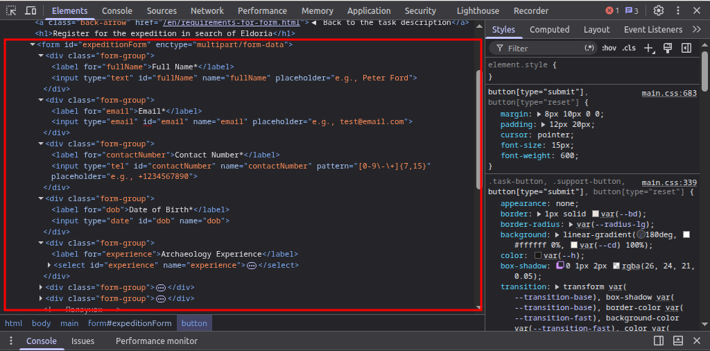

### Severity:
High

### Priority:
High
