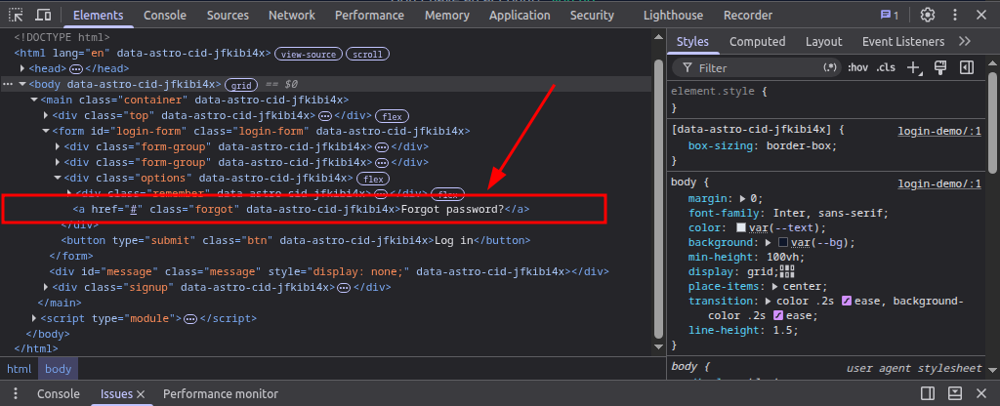
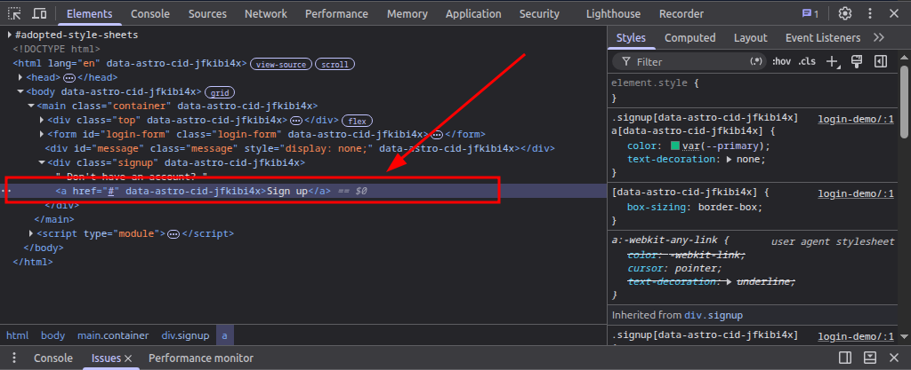
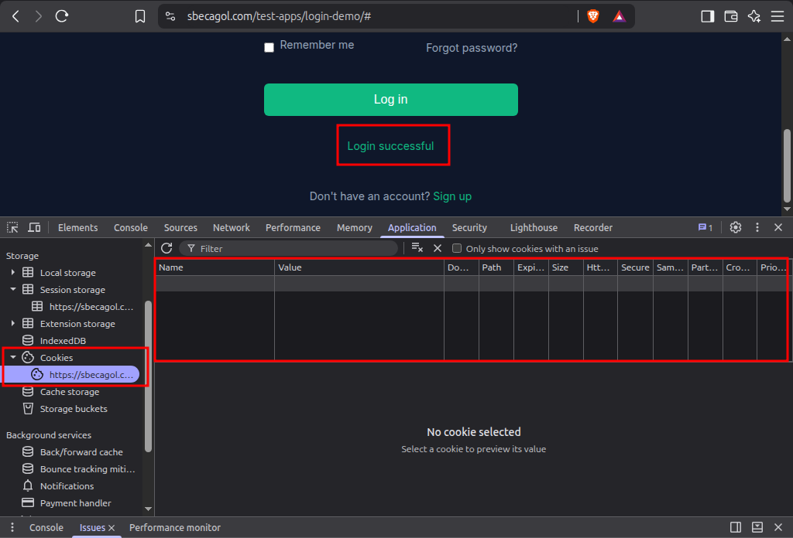
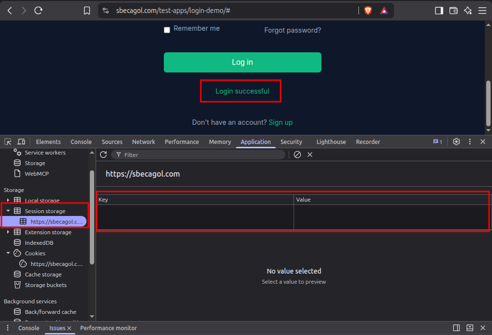

# Bug Reports – Login Demo App

**Environment:** BUG-001 to BUG-004 were found on desktop (Linux Mint, Brave [confirm version]). BUG-005 was found on real devices; see its Environment section. See the [test plan](./test-plan.md).

## Summary

| ID | Title | Related TC | Severity | Priority | Status |
|----|-------|:----------:|:--------:|:--------:|:------:|
| BUG-001 | "Forgot password?" button does nothing | TC-017 | Medium | Medium | Open |
| BUG-002 | "Sign up" button does nothing | TC-018 | Medium | Medium | Open |
| BUG-003 | "Remember me" does not persist the session | TC-019 | Medium | Medium | Open |
| BUG-004 | Tab key skips the "Remember me" checkbox | TC-020 | Low | Low | Open |
| BUG-005 | Theme toggle shows wrong colors in Via Night Mode | TC-022 | Medium | Medium | Open |

---

## BUG-001: Ineffective Forgot Password button

- **Related Test Cases:** TC-017

### Steps:
1. Open the Login Demo page.
2. Click the "**Forgot password?**" button.

### Expected Result:
- User is redirected to another page where he can change his password and restore his account.

### Actual Result:
- User is not redirected to another page where he can change his password and restore his account.

### Visual Evidence:
<video controls src="videos/forogt_password_button1.mp4" title="Title"></video>

### Technical Context:
* DevTools Elements:

### Severity:
Medium

### Priority:
Medium

---------------------------------

## BUG-002: Ineffective Sign Up button

- **Related Test Cases:** TC-018

### Steps:
1. Open the Login Demo page.
2. Click the "**Sign up**" button.

### Expected Result:
- User is redirected to another page where he can register for the first time and get an account.

### Actual Result:
- User is not redirected to another page where he can register for the first time and get an account.

### Visual Evidence:
<video controls src="videos/signup_button1.mp4" title="Title"></video>

### Technical Context:
* DevTools Elements:

### Severity:
Medium

### Priority:
Medium

---------------------------------

## BUG-003: Remember Me functionality does not persist the user's session

- **Related Test Cases:** TC-019

### Steps:
1. Check the "**Remember me**" checkbox.
2. Enter **demo** in the Username field.
3. Enter **password** in the Password field.
4. Click the "**Log In**" button.
5. Wait for successful login.
6. Close the browser completely.
7. Reopen the browser and navigate to the Login Demo page.

### Expected Result:
- The user is automatically logged in, or at least the username field is pre-filled.
- A persistent cookie or session token (with an expiry date) is stored in the browser.
- The password is never pre-filled or stored in plain text.

### Actual Result:
- The username field is not pre-filled.
- The user is not automatically logged in.
- No cookie or session token has been stored in the browser.

### Visual Evidence:
<video controls src="videos/checkbox1.mp4" title="Title"></video>

### Technical Context:
* DevTools Cookies:

- DevTools Session storage:

### Severity:
Medium

### Priority:
Medium

---------------------------------

## BUG-004: Keyboard tab order focus skips Remember me checkbox without focusing on it

- **Related Test Cases:** TC-020

### Steps:
1. Click outside the form (or press Esc) to ensure no field is focused.
2. Press the Tab key repeatedly, observing where focus lands after each press.
3. Note the sequence of focused elements.

### Expected Result:
- Focus moves in logical visual order: Back → Theme toggle → Username → Password → Remember me checkbox → Forgot password? link → Log In button → Sign up link.
- Each focused element displays a visible focus indicator (outline/highlight).
- No interactive element is skipped; no non-interactive element receives focus.
- Shift+Tab reverses the sequence correctly.

### Actual Result:
- Focus skips "**Remember me checkbox**" without focusing on it.
- Each focused element displays a visible focus indicator (outline/highlight) except "**Remember me checkbox**".
- One interactive element is skipped "**Remember me checkbox**"; no non-interactive element receives focus.

### Visual Evidence:
<video controls src="videos/tab_order1.mp4" title="Title"></video>

### Severity:
Low

### Priority:
Low

---------------------------------

## BUG-005: Theme toggle shows wrong colors in the Via browser's Night Mode (phone and tablet)

- **Related Test Cases:** TC-022

### Description:
The toggle button for switching between dark and light modes encounters a glitch when "Night Mode" is enabled in the "Via" browser settings on devices: (**Infinix Note 7 & Samsung Galaxy Tab A 2016**).

### Steps:
1. Open "**Via**" browser.
2. Navigate to the Login Demo page.
3. Click the "**Dark/Light mode**" switch button.

### Expected Result:
- Page switches from light to dark mode, and vice versa.
- Icon changes from crescent moon to sun, and vice versa.
- Clicking again reverses both changes.

### Actual Result:
- Page switches from dark to dark charcoal instead of light, and vice versa on the Infinix device.
- Page stays on dark charcoal in both cases on the Samsung device.
- Icon changes from crescent moon to sun, and vice versa.
- Clicking again reverses both changes.

### Environment:
- OS: Android 10 (Mobile), Android 8.1.0 (Tablet)
- Browser version: Via 7.1.0 (On the Infinix) Via 7.3.3 (On the Samsung)
- Devices: Infinix Note 7 & Samsung Galaxy Tab A 2016

### Visual Evidence:
- Infinix Note 7:
<video controls src="videos/theme_toggle_phone1.mp4" title="Title"></video>

* Samsung Galaxy Tab A 2016:
<video controls src="videos/theme_toggle_tablet1.mp4" title="Title"></video>

### Severity:
Medium

### Priority:
Medium
