# Bug Reports – Practice Software Testing (Toolshop)

**Environment:** Linux Mint Zena (XFCE) · Brave 1.93.138 · Desktop. Main build: with-bugs Sprint 5 (https://with-bugs.practicesoftwaretesting.com). Comparison build: clean Sprint 5 (https://practicesoftwaretesting.com). See the [test plan](./test-plan.md) for the severity and priority definitions.

> **Reproduces on clean:** *Yes* = also present on the clean build (a pre-existing defect). *No* = only on the with-bugs build. *Clean-only* = found on the clean build only. *Partly* = some items of the bug also occur on the clean build.

## Summary

| ID | Title | Area | Severity | Priority | Reproduces on clean |
|----|-------|------|:--------:|:--------:|:-------------------:|
| [BUG-001](#bug-001-application-logo-is-not-visible-but-still-clickable) | Logo not visible | Navigation | Low | Medium | No |
| [BUG-002](#bug-002-home-tab-stays-active-on-every-page) | Home tab always active | Navigation | Low | Low | No |
| [BUG-003](#bug-003-home-tab-opens-the-contact-page) | Home tab opens the Contact page | Navigation | Medium | High | No |
| [BUG-004](#bug-004-browser-back-from-a-product-page-loses-the-search-results-and-returns-to-the-home-page) | Back loses the search results | Navigation | Medium | Medium | Yes |
| [BUG-005](#bug-005-browser-back-from-a-product-page-on-ads-page-2-or-3-returns-to-the-home-page-instead-of-the-same-ads-page) | Back loses the ads page | Navigation | Medium | Medium | Yes |
| [BUG-006](#bug-006-browser-back-from-a-product-page-resets-all-selected-filters) | Back resets the filters | Navigation | Medium | Medium | Yes |
| [BUG-007](#bug-007-spelling-errors-in-the-ui-contakt-sorth-reltded-products) | Spelling errors in the UI | Content | Low | Low | No |
| [BUG-008](#bug-008-search-icon-magnifying-glass-is-not-visible) | Search icon not visible | Catalog | Low | Low | No |
| [BUG-009](#bug-009-entering-characters-in-search-field-makes-ad-titles-jump-leftright-consistently-per-keystroke) | Ad titles jump while typing in search | Catalog | Low | Medium | No |
| [BUG-010](#bug-010-sorting-reorders-the-product-list-in-reverse) | Sorting order is reversed | Catalog | Medium | Medium | No |
| [BUG-011](#bug-011-price-range-filter-does-nothing) | Price Range filter does nothing | Catalog | Medium | Medium | No |
| [BUG-012](#bug-012-brand-filter-shows-placeholder-names-and-only-two-work) | Brand filter placeholders, only two work | Catalog | Medium | Medium | No |
| [BUG-013](#bug-013-category-undefined-is-listed-and-contains-nothing) | "UNDEFINED" category is empty | Catalog | Medium | Medium | No |
| [BUG-014](#bug-014-chainsaws-category-returns-404) | Chainsaws category returns 404 | Catalog | Medium | Medium | No |
| [BUG-015](#bug-015-sustainability-filter-does-nothing) | Sustainability filter does nothing | Catalog | Medium | Medium | No |
| [BUG-016](#bug-016-three-ads-do-not-show-their-images-until-clicked) | Three ads show no image until clicked | Catalog | Low | Low | No |
| [BUG-017](#bug-017-add-to-cart-and-add-to-favourites-buttons-overlap) | Add to cart and favourites buttons overlap | Product details | Low | Medium | No |
| [BUG-018](#bug-018-error-message-appears-after-successfully-adding-to-cart-or-favourites) | Error message after a successful add | Cart and favourites | Medium | High | No |
| [BUG-019](#bug-019-some-ads-descriptions-overlap-with-their-images-inside-the-favourites-page) | Favourites descriptions overlap images | Cart and favourites | Low | Low | Yes |
| [BUG-020](#bug-020-clicking-on-the-ad-inside-the-favourites-page-does-not-open-the-product-details-page) | Ad in favourites does not open | Cart and favourites | Medium | Medium | Yes |
| [BUG-021](#bug-021-total-heading-is-duplicated-in-the-cart-table) | Duplicate Total heading | Cart and favourites | Low | Low | No |
| [BUG-022](#bug-022-line-totals-in-the-cart-show-0000) | Line totals show $00.00 | Cart and favourites | High | High | No |
| [BUG-023](#bug-023-delete-button-in-the-cart-does-not-remove-products) | Cart delete button does nothing | Cart and favourites | Medium | High | No |
| [BUG-024](#bug-024-country-and-state-fields-are-swapped-on-the-register-page) | Country and State swapped | Account | Medium | Medium | No |
| [BUG-025](#bug-025-date-of-birth-over-the-age-limit-of-75-is-accepted) | Date of birth over 75 accepted | Account | Medium | Medium | Yes |
| [BUG-026](#bug-026-invalid-postcode-is-accepted-on-registration) | Invalid postcode accepted | Account | Medium | Medium | Yes |
| [BUG-027](#bug-027-user-data-not-found-replaces-the-account-tab-after-login) | "User Data not found" in the header | Account | Medium | High | No |
| [BUG-028](#bug-028-sql-injection-payload-in-the-email-field-bypasses-the-login) | SQL injection bypasses the login | Account | Critical | High | No |
| [BUG-029](#bug-029-server-returns-500-internal-server-error-when-submitting-sql-injection-style-payload----in-login-email-field) | 500 error on a login payload | Account | High | High | No |
| [BUG-030](#bug-030-capitalised-email-address-on-registration-shows-e-mail-format-is-invalid-instead-of-the-duplicate-email-message) | Capitalised email gives the wrong message | Account | Medium | Medium | No |
| [BUG-031](#bug-031-registering-with-an-existing-email-returns-a-password-hint-message) | Existing email shows a password hint | Account | Medium | Medium | No |
| [BUG-032](#bug-032-update-profile-returns-resource-not-found) | Update Profile fails | Account | High | High | No |
| [BUG-033](#bug-033-changing-the-password-while-logged-in-locks-the-user-out) | Password change locks the user out | Account | Critical | High | No |
| [BUG-034](#bug-034-resetting-a-forgotten-password-locks-the-user-out) | Forgot password locks the user out | Account | Critical | High | Yes |
| [BUG-035](#bug-035-city-field-in-the-profile-page-shows-city-not-found-instead-of-the-users-city) | Profile shows "City not found" | Account | Medium | Medium | No |
| [BUG-036](#bug-036-step-indicator-stops-working-at-the-final-checkout-step-payment) | Step indicator stops working at Payment | Checkout | Medium | Medium | Yes |
| [BUG-037](#bug-037-continue-button-in-the-billing-address-step-has-no-label) | Billing continue button has no label | Checkout | Low | Medium | No |
| [BUG-038](#bug-038-postcode-field-in-the-billing-address-is-pre-filled-with-missing-value) | Postcode pre-filled "missing value" | Checkout | Medium | Medium | No |
| [BUG-039](#bug-039-house-number-field-in-the-billing-address-is-not-pre-filled-clean-sprint-5) | House number not pre-filled (clean) | Checkout | Medium | Medium | Clean-only |
| [BUG-040](#bug-040-account-name-and-number-are-required-for-every-payment-method) | Payment fields required for every method | Checkout | Medium | High | No |
| [BUG-041](#bug-041-normal-purchase-creates-no-invoice-and-shows-no-invoice-number) | No invoice after a normal purchase | Invoices | High | High | Yes |
| [BUG-042](#bug-042-invoice-created-through-the-chat-assistant-shows-method-not-found-and-undefined-fields) | Invoice details show "undefined" | Invoices | Medium | Medium | No |
| [BUG-043](#bug-043-purchasing-through-chat-assistant-encountered-an-error-on-the-clean-sprint-5) | Chat purchase fails (clean) | Chat Assistant | High | High | Clean-only |
| [BUG-044](#bug-044-contact-subject-options-have-3-visual-errors) | Subject options show errors | Contact | Low | Medium | No |
| [BUG-045](#bug-045-contact-attachment-label-does-not-match-the-behaviour-with-bugs-build) | Attachment label does not match behaviour | Contact | Medium | Medium | No |
| [BUG-046](#bug-046-attachment-rule-only-txt-files-0-kb-makes-the-field-unusable-clean-build) | Attachment rule allows empty files only | Contact | Medium | Medium | Clean-only |
| [BUG-047](#bug-047-message-details-button-opens-the-most-recent-message-instead-of-the-selected-one) | Message details open the latest message | Contact | High | Medium | No |
| [BUG-048](#bug-048-product-images-do-not-show-when-searching-for-products-via-the-chat-assistant) | Chat results show no images | Chat Assistant | Low | Medium | No |
| [BUG-049](#bug-049-cart-does-not-show-the-product-name-and-price-after-adding-a-product-through-the-chat-assistant) | Cart shows no name or price after a chat add | Chat Assistant | Medium | Medium | No |
| [BUG-050](#bug-050-re-adding-a-product-already-in-the-cart-through-the-chat-assistant-replaces-the-quantity-instead-of-increasing-it) | Re-adding a product replaces the quantity | Chat Assistant | Medium | Medium | No |
| [BUG-051](#bug-051-chat-assistant-shows-a-generic-error-instead-of-asking-for-valid-data-after-a-purchase-attempt-with-invalid-data) | Generic error for invalid purchase data | Chat Assistant | Medium | Medium | Yes |
| [BUG-052](#bug-052-keyboard-focus-order-is-wrong-or-skips-interactive-elements) | Tab order wrong or skips elements | Keyboard Accessibility | Medium | Medium | Partly |
| [BUG-053](#bug-053-chat-assistant-exit-button-has-no-visible-focus-indicator-and-the-product-highlight-replaces-the-comparison-tag-focus-clean-build) | Missing or wrong focus indicators (clean) | Keyboard Accessibility | Low | Low | Clean-only |
| [BUG-054](#bug-054-focused-rental-product-cards-cannot-be-opened-with-the-enter-key) | Rental cards not openable with Enter | Keyboard Accessibility | Medium | Medium | Yes |
| [BUG-055](#bug-055-chat-assistant-search-returns-products-for-injection-style-payloads-on-the-with-bugs-build) | Chat search returns products for injection payloads | Chat Assistant | High | High | No |

## Bug Details

### BUG-001: Application logo is not visible (but still clickable)

- **Severity:** Low  |  **Priority:** Medium  |  **Status:** Open
- **Requirement:** REQ-NAV-01  |  **Related test case:** [TC-001](./test-cases.md#tc-001-logo-is-visible-and-links-to-the-home-page)
- **Area:** Navigation  |  **Build:** With-bugs Sprint 5  |  **Reproduces on clean:** No
- **Priority rationale:** The logo is missing on every page, so everyone sees the problem even though the site still works.

#### Steps
1. Open the home page.
2. Look at the logo area in the header.
3. Click the logo area.

#### Expected
The logo is visible, and clicking it opens the home page.

#### Actual
The logo is not visible, but clicking its area opens the home page.

#### Visual Evidence
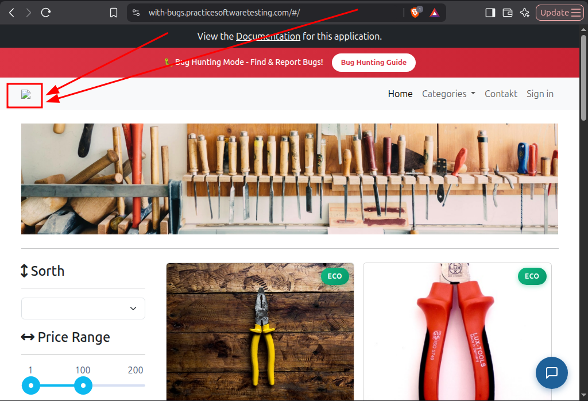

#### Technical Context
* DevTools Elements:
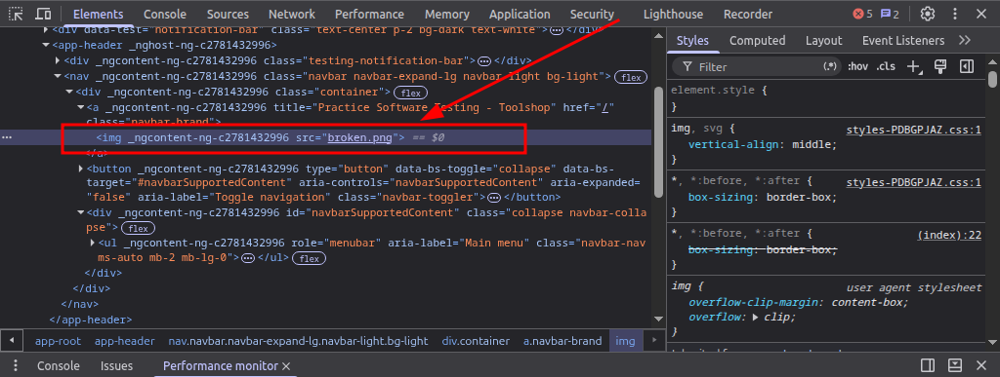

- Console logs:
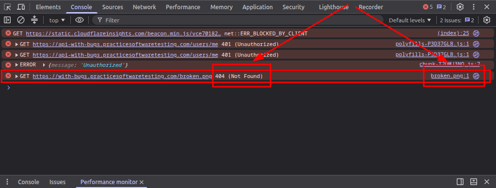

---

### BUG-002: Home tab stays active on every page

- **Severity:** Low  |  **Priority:** Low  |  **Status:** Open
- **Requirement:** REQ-NAV-02  |  **Related test case:** [TC-002](./test-cases.md#tc-002-navigation-bar-highlights-the-current-page)
- **Area:** Navigation  |  **Build:** With-bugs Sprint 5  |  **Reproduces on clean:** No

#### Steps
1. Open the home page.
2. Click another navigation tab, for example Contact.
3. Check which tab is highlighted.

#### Expected
The tab of the current page is highlighted.

#### Actual
Only the home tab gets the Bootstrap "active" class, so it is always highlighted.

#### Visual Evidence
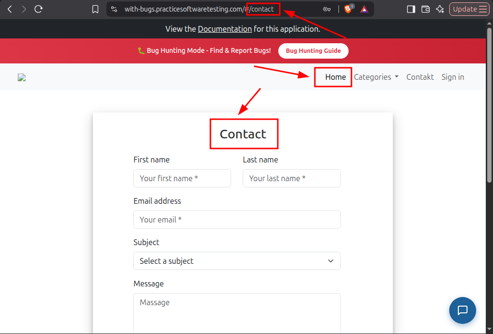

#### Technical Context
* DevTools Elements:
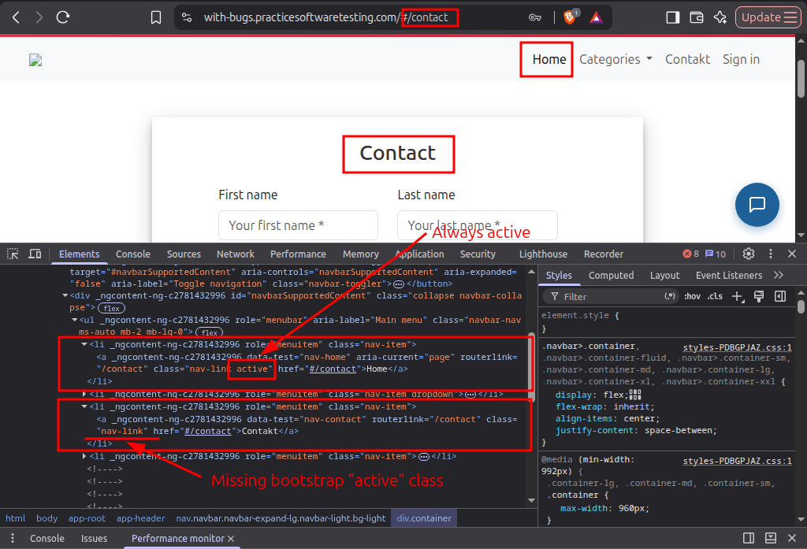

---

### BUG-003: Home tab opens the Contact page

- **Severity:** Medium  |  **Priority:** High  |  **Status:** Open
- **Requirement:** REQ-NAV-03  |  **Related test case:** [TC-003](./test-cases.md#tc-003-home-tab-opens-the-home-page)
- **Area:** Navigation  |  **Build:** With-bugs Sprint 5  |  **Reproduces on clean:** No
- **Priority rationale:** Core navigation is broken, so the fix is urgent even though the page can be reached by other routes.

#### Steps
1. Open any page other than the home page.
2. Click Home in the navigation bar.

#### Expected
The home page opens.

#### Actual
- The Contact page opens.
- **Bug**: The navigation link labeled "Home" incorrectly points to /contact instead of /. Both the routerLink and href attributes are misdirected to the contact page, and you can see it clearly here in this chunk of code taken from the project's html code:-
```<a _ngcontent-ng-c2781432996="" data-test="nav-home" aria-current="page" routerlink="/contact" class="nav-link active" href="#/contact">Home</a>```

#### Visual Evidence
[▶ Watch the clip](videos/home_tab_opens_contact_page1.webp) · [MP4](videos/home_tab_opens_contact_page1.mp4)

#### Technical Context
* DevTools Elements:
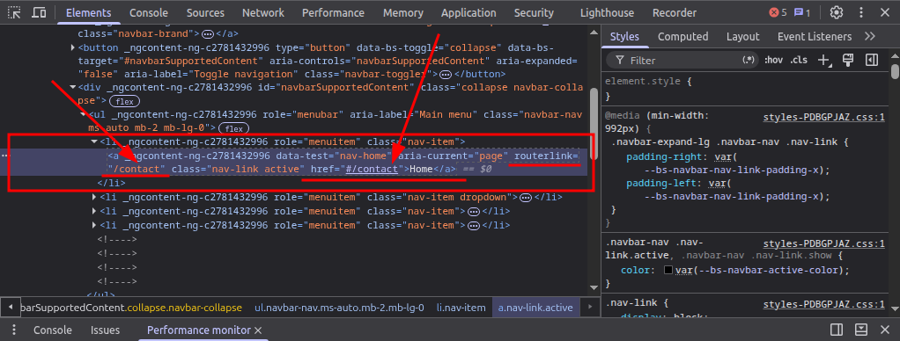

---

### BUG-004: Browser Back from a product page loses the search results and returns to the home page

- **Severity:** Medium  |  **Priority:** Medium  |  **Status:** Open
- **Requirement:** REQ-NAV-04  |  **Related test case:** [TC-005](./test-cases.md#tc-005-verify-back-navigation-from-ad-detail-preserves-search-results)
- **Area:** Navigation  |  **Build:** With-bugs and clean Sprint 5  |  **Reproduces on clean:** Yes

#### Steps
1. Enter a search query (e.g., "bolts").
2. Click on an ad result to view the product details.
3. Click the browser/app "Back" button.

#### Expected
User is returned to the Search Results page.

#### Actual
User is not returned to the Search Results page, instead, they're being redirected to the home page, and all the search results are lost.

#### Visual Evidence
- With-bugs Sprint 5:
[▶ Watch the clip](videos/with_bugs_search_back_faulted1.webp) · [MP4](videos/with_bugs_search_back_faulted1.mp4)

* Clean Sprint 5:
[▶ Watch the clip](videos/clean_sprint_search_back_faulted1.webp) · [MP4](videos/clean_sprint_search_back_faulted1.mp4)

---

### BUG-005: Browser Back from a product page on ads page 2 or 3 returns to the home page instead of the same ads page

- **Severity:** Medium  |  **Priority:** Medium  |  **Status:** Open
- **Requirement:** REQ-NAV-04  |  **Related test case:** [TC-006](./test-cases.md#tc-006-verify-back-navigation-from-ad-detail-preserves-current-ads-page)
- **Area:** Navigation  |  **Build:** With-bugs and clean Sprint 5  |  **Reproduces on clean:** Yes

#### Steps
1. Open the Home page.
2. Navigate to the next ads page.
3. Click on one of the ads in this page.

#### Expected
User is returned to the current page, and not redirected to the home page.

#### Actual
User is not returned to the current page, and instead, they're actually redirected to the home page.

#### Visual Evidence
- With-bugs Sprint 5:
[▶ Watch the clip](videos/with_bugs_ads_page_back_faulted1.webp) · [MP4](videos/with_bugs_ads_page_back_faulted1.mp4)

* Clean Sprint 5:
[▶ Watch the clip](videos/clean_sprint_ads_page_back_faulted1.webp) · [MP4](videos/clean_sprint_ads_page_back_faulted1.mp4)

---

### BUG-006: Browser Back from a product page resets all selected filters

- **Severity:** Medium  |  **Priority:** Medium  |  **Status:** Open
- **Requirement:** REQ-NAV-04  |  **Related test case:** [TC-007](./test-cases.md#tc-007-verify-selected-filters-persist-when-navigating-back-from-product-detail)
- **Area:** Navigation  |  **Build:** With-bugs and clean Sprint 5  |  **Reproduces on clean:** Yes

#### Steps
1. Apply category filter (e.g., "Power Tools > Sander").
2. Apply brand filter (e.g., "Brand name 1").
3. Click an ad/product to open detail view.
4. Click browser/app "Back" button.

#### Expected
Return to filtered search results + checkboxes preserved.

#### Actual
- Redirected to Home page.
- All checkboxes unchecked.
- Search results lost.

#### Visual Evidence
- With-bugs Sprint 5:
[▶ Watch the clip](videos/with_bugs_filter_back_faulted1.webp) · [MP4](videos/with_bugs_filter_back_faulted1.mp4)

* Clean Sprint 5:
[▶ Watch the clip](videos/clean_sprint_filter_back_faulted1.webp) · [MP4](videos/clean_sprint_filter_back_faulted1.mp4)

---

### BUG-007: Spelling errors in the UI ("Contakt", "Sorth", "Reltded products")

- **Severity:** Low  |  **Priority:** Low  |  **Status:** Open
- **Requirement:** REQ-CON-01, REQ-PRD-02  |  **Related test case:** [TC-008](./test-cases.md#tc-008-ui-text-is-spelled-correctly), [TC-020](./test-cases.md#tc-020-the-layout-inside-the-ad-details-page-does-not-overlap-and-its-free-of-any-other-design-flaws)
- **Area:** Content  |  **Build:** With-bugs Sprint 5  |  **Reproduces on clean:** No

#### Steps
1. Read the navigation bar labels.
2. Read the sorting control on the product list.
3. Open a product and read the related products title.

#### Expected
"Contact", "Sort", and "Related products".

#### Actual
- **"Contakt"** in the navigation bar.
- **"Sorth"** on the sorting control.
- **"Reltded products"** on the product page.

#### Visual Evidence
- Contakt & Sorth:
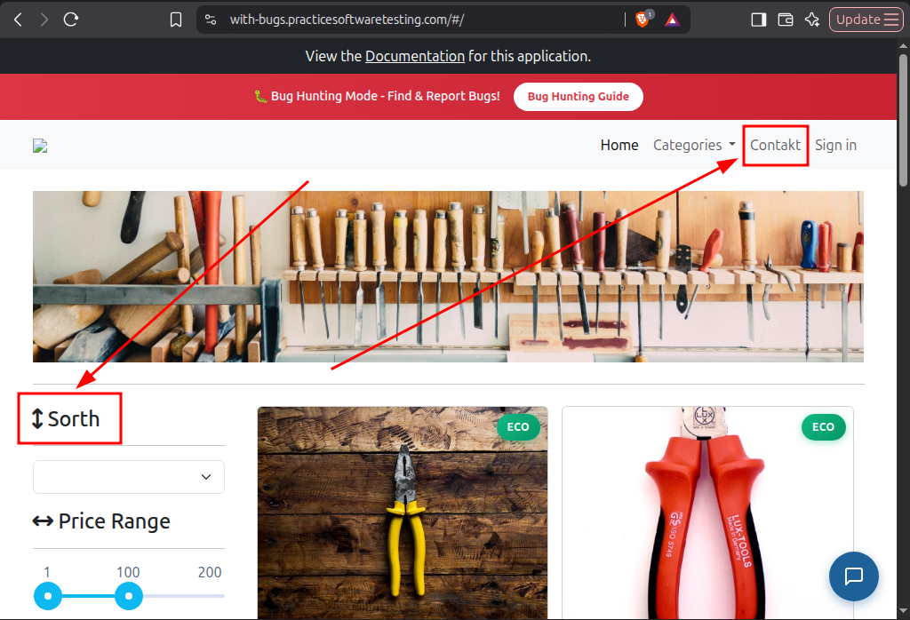

* Reltded products:
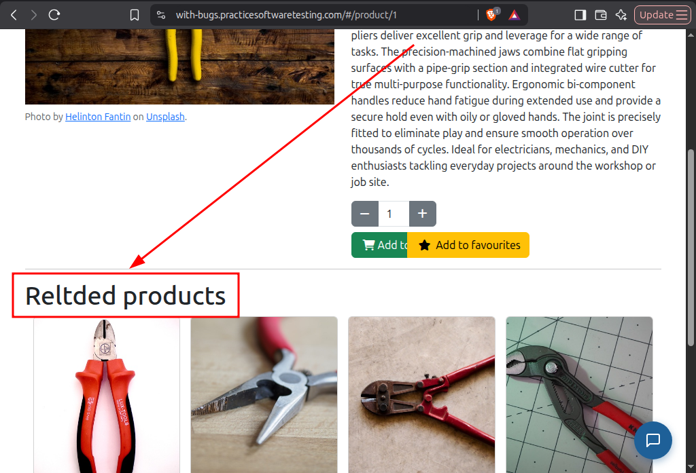

---

### BUG-008: Search icon (magnifying glass) is not visible

- **Severity:** Low  |  **Priority:** Low  |  **Status:** Open
- **Requirement:** REQ-CAT-02  |  **Related test case:** [TC-011](./test-cases.md#tc-011-search-icon-is-visible)
- **Area:** Catalog  |  **Build:** With-bugs Sprint 5  |  **Reproduces on clean:** No

#### Steps
1. Open the home page.
2. Look at the search field.

#### Expected
A magnifying-glass icon is visible.

#### Actual
The icon is broken and not visible.

#### Visual Evidence
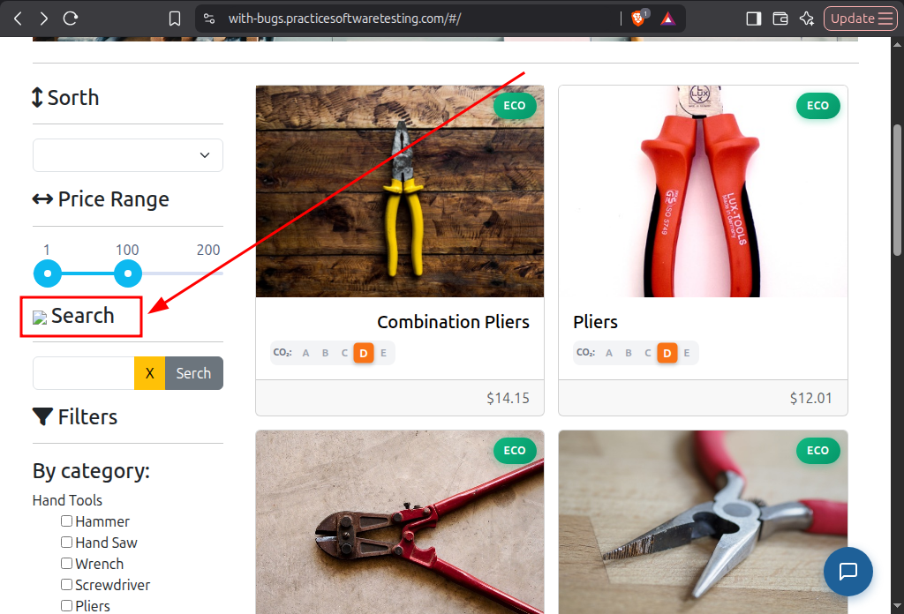

#### Technical Context
* DevTools Elements:
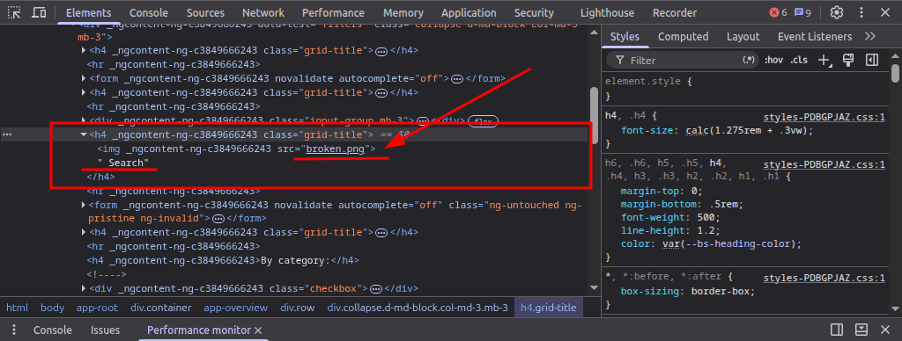

---

### BUG-009: Entering characters in search field makes ad titles jump left/right consistently per keystroke

- **Severity:** Low  |  **Priority:** Medium  |  **Status:** Open
- **Requirement:** REQ-CAT-07  |  **Related test case:** [TC-012](./test-cases.md#tc-012-verify-ad-layout-stability-during-search-input)
- **Area:** Catalog  |  **Build:** With-bugs Sprint 5  |  **Reproduces on clean:** No
- **Priority rationale:** The movement is cosmetic, but it happens while using the main search field.

#### Steps
1. Open the home page.
2. Go to the search field.
3. Enter anything in the field.
4. Watch ad layout stability during search input.

#### Expected
Ad layout remains stable while typing.

#### Actual
Ad titles jump left/right consistently per keystroke.

#### Impact
Distracting, makes the page feel unstable; users may lose focus mid-query or mistake the movement for a page reload.

#### Visual Evidence
[▶ Watch the clip](videos/entering_search_field_effects_ads_layout1.webp) · [MP4](videos/entering_search_field_effects_ads_layout1.mp4)

---

### BUG-010: Sorting reorders the product list in reverse

- **Severity:** Medium  |  **Priority:** Medium  |  **Status:** Open
- **Requirement:** REQ-CAT-03  |  **Related test case:** [TC-013](./test-cases.md#tc-013-sorting-reorders-the-product-list)
- **Area:** Catalog  |  **Build:** With-bugs Sprint 5  |  **Reproduces on clean:** No

#### Steps
1. Open the Home page.
2. Go to the **Sort** section.
3. Choose a sort option.
4. Check the order of the products.

#### Expected
Products are reordered according to the option.

#### Actual
- Products are reordered, but not according to the option; the order is reversed.
- In the html code, the asc/desc sorting logic is applied backwards.

#### Visual Evidence
[▶ Watch the clip](videos/sorting_reorders_in_reverse1.webp) · [MP4](videos/sorting_reorders_in_reverse1.mp4)

#### Technical Context
* DevTools Elements tab:
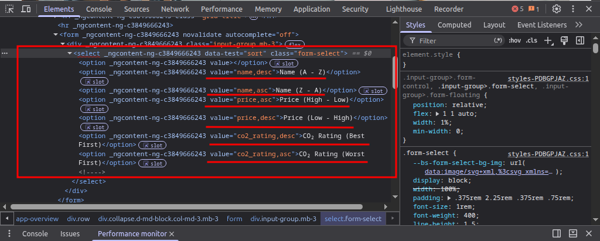

---

### BUG-011: Price Range filter does nothing

- **Severity:** Medium  |  **Priority:** Medium  |  **Status:** Open
- **Requirement:** REQ-CAT-08  |  **Related test case:** [TC-014](./test-cases.md#tc-014-the-price-range-feature-filters-listings-according-to-the-price-range-selected-by-the-user)
- **Area:** Catalog  |  **Build:** With-bugs Sprint 5  |  **Reproduces on clean:** No

#### Steps
1. Open the Home page.
2. Go to the **Price Range** section.
3. Choose a price range by moving the range slider handles.
4. Check how the products are displayed after applying the price range.

#### Expected
Products are in the price range are displayed, while products out of range are not.

#### Actual
- Nothing happens, only ad titles jump left/right consistently with every movement of the handle.
- Status Code: 204 No Content

#### Visual Evidence
[▶ Watch the clip](videos/price_range_reorders_in_reverse1.webp) · [MP4](videos/price_range_reorders_in_reverse1.mp4)

#### Technical Context
* DevTools Network tab:
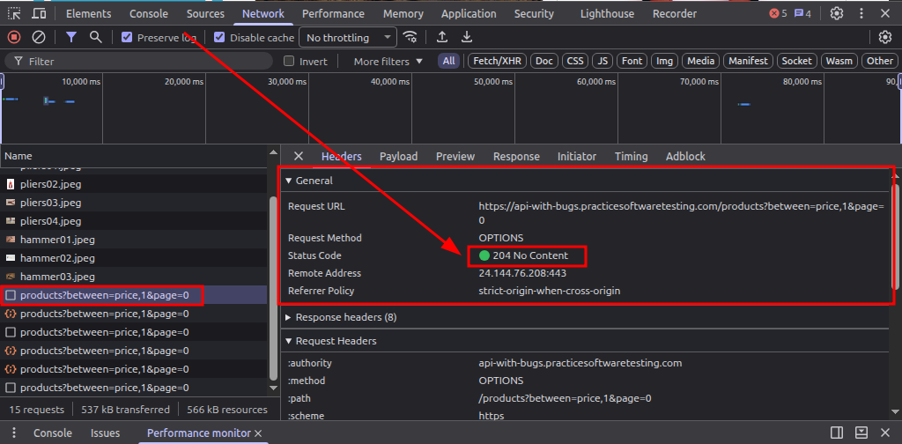

---

### BUG-012: Brand filter shows placeholder names and only two work

- **Severity:** Medium  |  **Priority:** Medium  |  **Status:** Open
- **Requirement:** REQ-CAT-04  |  **Related test case:** [TC-015](./test-cases.md#tc-015-brand-filter-shows-real-names-and-filters-products)
- **Area:** Catalog  |  **Build:** With-bugs Sprint 5  |  **Reproduces on clean:** No

#### Steps
1. Open the Home page.
2. Go to the **By brand** filter section.
3. Read the brand names.
4. Select each brand.

#### Expected
Real brand names are shown, and each brand filters the list.

#### Actual
Names are "Brand name 1" to "Brand name 10", and only 1 and 2 filter products.

#### Visual Evidence
[▶ Watch the clip](videos/brand_filter_faulted1.webp) · [MP4](videos/brand_filter_faulted1.mp4)

---

### BUG-013: Category "UNDEFINED" is listed and contains nothing

- **Severity:** Medium  |  **Priority:** Medium  |  **Status:** Open
- **Requirement:** REQ-CAT-05  |  **Related test case:** [TC-016](./test-cases.md#tc-016-all-categories-in-the-navbar-and-in-the-filters-have-real-names-and-show-products)
- **Area:** Catalog  |  **Build:** With-bugs Sprint 5  |  **Reproduces on clean:** No

#### Steps
1. Open the Categories menu.
2. Open the "**UNDEFINED**" category.

#### Expected
No unnamed category exists, or it shows products.

#### Actual
The "UNDEFINED" category exists and contains no products or data.

#### Visual Evidence
[▶ Watch the clip](videos/UNDEFINED_category1.webp) · [MP4](videos/UNDEFINED_category1.mp4)

---

### BUG-014: Chainsaws category returns 404

- **Severity:** Medium  |  **Priority:** Medium  |  **Status:** Open
- **Requirement:** REQ-CAT-05  |  **Related test case:** [TC-016](./test-cases.md#tc-016-all-categories-in-the-navbar-and-in-the-filters-have-real-names-and-show-products)
- **Area:** Catalog  |  **Build:** With-bugs Sprint 5  |  **Reproduces on clean:** No

#### Steps
1. Open the Categories menu.
2. Open the "**Chainsaws**" category.

#### Expected
The category page shows its products.

#### Actual
A 404 Page Not Found error appears.

#### Visual Evidence
[▶ Watch the clip](videos/chainsaws_category_error_4041.webp) · [MP4](videos/chainsaws_category_error_4041.mp4)

---

### BUG-015: Sustainability filter does nothing

- **Severity:** Medium  |  **Priority:** Medium  |  **Status:** Open
- **Requirement:** REQ-CAT-09  |  **Related test case:** [TC-017](./test-cases.md#tc-017-sustainability-filter-filters-products)
- **Area:** Catalog  |  **Build:** With-bugs Sprint 5  |  **Reproduces on clean:** No

#### Steps
1. Open the Home page.
2. Go to the **Sustainability** filter section, and check the box.

#### Expected
Only eco-friendly products are shown.

#### Actual
Nothing changes, only ad titles jump left/right consistently by every click on the checkbox.

#### Visual Evidence
[▶ Watch the clip](videos/sustainability_filter_unfunctional1.webp) · [MP4](videos/sustainability_filter_unfunctional1.mp4)

---

### BUG-016: Three ads do not show their images until clicked

- **Severity:** Low  |  **Priority:** Low  |  **Status:** Open
- **Requirement:** REQ-CAT-06  |  **Related test case:** [TC-018](./test-cases.md#tc-018-ads-display-their-images-names-and-prices)
- **Area:** Catalog  |  **Build:** With-bugs Sprint 5  |  **Reproduces on clean:** No

#### Steps
1. Open the home page.
2. Look at these three ads and click on each one of them:
   1. **Slip Joint Pliers** "First page".
   2. **Wood Saw** "Second page".
   3. **Belt Sander** "Third page".

#### Expected
All three ads show their images.

#### Actual
The images appear only after clicking the ad and opening the product.

#### Visual Evidence
[▶ Watch the clip](videos/ads_not_show_images1.webp) · [MP4](videos/ads_not_show_images1.mp4)

---

### BUG-017: Add to cart and Add to favourites buttons overlap

- **Severity:** Low  |  **Priority:** Medium  |  **Status:** Open
- **Requirement:** REQ-PRD-02  |  **Related test case:** [TC-020](./test-cases.md#tc-020-the-layout-inside-the-ad-details-page-does-not-overlap-and-its-free-of-any-other-design-flaws)
- **Area:** Product details  |  **Build:** With-bugs Sprint 5  |  **Reproduces on clean:** No
- **Priority rationale:** The buttons are still clickable, but they are the main purchase controls on the page.

#### Steps
1. Open any product.
2. Look at the Add to cart and Add to favourites buttons.

#### Expected
The buttons are separate and clickable.

#### Actual
The buttons overlap but still clickable.

#### Visual Evidence
[▶ Watch the clip](videos/buttons_overlap1.webp) · [MP4](videos/buttons_overlap1.mp4)

---

### BUG-018: Error message appears after successfully adding to cart or favourites

- **Severity:** Medium  |  **Priority:** High  |  **Status:** Open
- **Requirement:** REQ-CRT-01  |  **Related test case:** [TC-021](./test-cases.md#tc-021-adding-a-product-to-the-cart-shows-a-success-message), [TC-022](./test-cases.md#tc-022-adding-a-product-to-favourites-shows-a-success-message)
- **Area:** Cart and favourites  |  **Build:** With-bugs Sprint 5  |  **Reproduces on clean:** No
- **Priority rationale:** Every add to cart shows an error, so users believe the action failed.

#### Steps
1. Open any product.
2. Click Add to cart, then Add to favourites.
3. Read the message, then open the cart and the favourites list.

#### Expected
A success message appears.

#### Actual
The error "Oeps, something went wrong" appears, but the product is added to both lists.

#### Visual Evidence
[▶ Watch the clip](videos/add_to_cart_and_favourites_error_message1.webp) · [MP4](videos/add_to_cart_and_favourites_error_message1.mp4)

---

### BUG-019: Some ads descriptions overlap with their images inside the Favourites page

- **Severity:** Low  |  **Priority:** Low  |  **Status:** Open
- **Requirement:** REQ-CRT-04  |  **Related test case:** [TC-023](./test-cases.md#tc-023-the-layout-inside-the-favorites-page-does-not-overlap-and-its-free-of-any-other-design-flaws-and-everything-is-functional)
- **Area:** Cart and favourites  |  **Build:** With-bugs and clean Sprint 5  |  **Reproduces on clean:** Yes

#### Steps
1. Log in with valid credentials.
2. Open any product and add it to your favourites.
3. Go to the favourites list in the user data section.
4. Check the ads layout.

#### Expected
Everything inside the page is clean and functional.

#### Actual
Some ads descriptions overlap with their images.

#### Visual Evidence
- With-bugs Sprint 5:
[▶ Watch the clip](videos/favourites_descriptions_and_images_overlap_with_bugs1.webp) · [MP4](videos/favourites_descriptions_and_images_overlap_with_bugs1.mp4)

* Clean Sprint 5:
[▶ Watch the clip](videos/favourites_descriptions_and_images_overlap_clean_sprint1.webp) · [MP4](videos/favourites_descriptions_and_images_overlap_clean_sprint1.mp4)

---

### BUG-020: Clicking on the ad inside the favourites page does not open the product details page

- **Severity:** Medium  |  **Priority:** Medium  |  **Status:** Open
- **Requirement:** REQ-CRT-04  |  **Related test case:** [TC-023](./test-cases.md#tc-023-the-layout-inside-the-favorites-page-does-not-overlap-and-its-free-of-any-other-design-flaws-and-everything-is-functional)
- **Area:** Cart and favourites  |  **Build:** With-bugs and clean Sprint 5  |  **Reproduces on clean:** Yes

#### Steps
1. Log in with valid credentials.
2. Open any product and add it to your favourites.
3. Go to the favourites list in the user data section.
4. Click on any ad on the list.

#### Expected
The product details page opened once the user clicked on the ad.

#### Actual
Clicking on the ad does not open the product details page, and user remains on the favourites page.

#### Visual Evidence
- With-bugs Sprint 5:
[▶ Watch the clip](videos/clicking_on_ad_in_favourites_does_not_open_with_bugs1.webp) · [MP4](videos/clicking_on_ad_in_favourites_does_not_open_with_bugs1.mp4)

* Clean Sprint 5:
[▶ Watch the clip](videos/clicking_on_ad_in_favourites_does_not_open_clean_sprint1.webp) · [MP4](videos/clicking_on_ad_in_favourites_does_not_open_clean_sprint1.mp4)

---

### BUG-021: "Total" heading is duplicated in the cart table

- **Severity:** Low  |  **Priority:** Low  |  **Status:** Open
- **Requirement:** REQ-CRT-02  |  **Related test case:** [TC-025](./test-cases.md#tc-025-cart-table-has-clean-layout)
- **Area:** Cart and favourites  |  **Build:** With-bugs Sprint 5  |  **Reproduces on clean:** No

#### Steps
1. Add a product to the cart.
2. Open the cart.
3. Read the table headings.

#### Expected
One Total heading is shown.

#### Actual
"Total" appears twice: above the line totals and above the delete buttons.

#### Visual Evidence
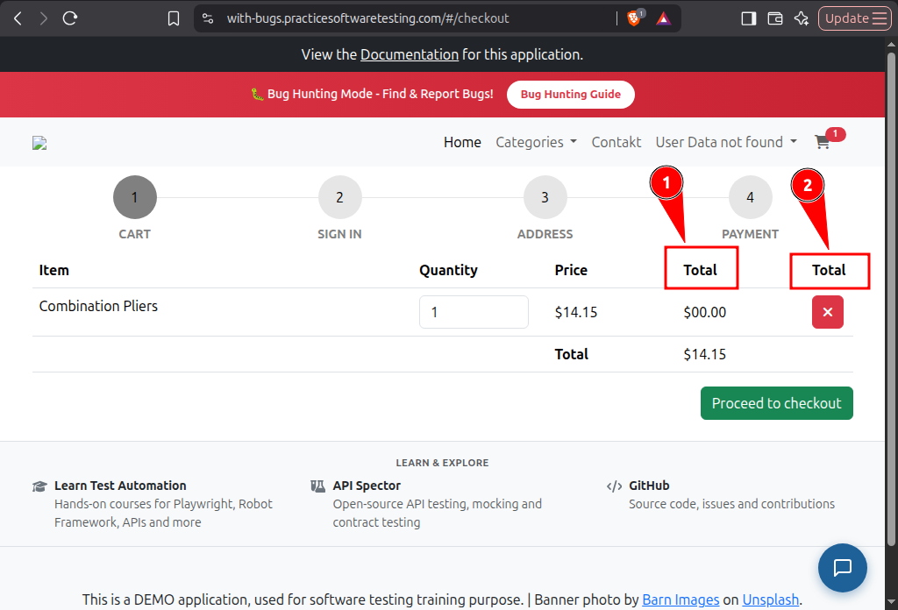

#### Technical Context
* DevTools Elements tab:
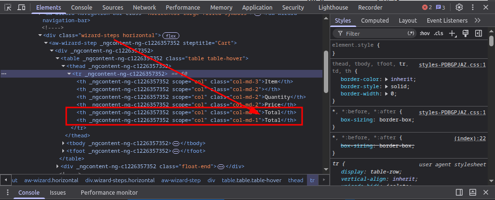

---

### BUG-022: Line totals in the cart show $00.00

- **Severity:** High  |  **Priority:** High  |  **Status:** Open
- **Requirement:** REQ-CRT-02  |  **Related test case:** [TC-026](./test-cases.md#tc-026-items-quantity-price-line-total-and-total-are-real-and-mathematically-correct)
- **Area:** Cart and favourites  |  **Build:** With-bugs Sprint 5  |  **Reproduces on clean:** No

#### Steps
1. Add a product to the cart.
2. Open the cart.
3. Compare the line total with the product price.

#### Expected
The line total equals quantity multiplied by price.

#### Actual
The line total shows $00.00 whatever the price.

#### Visual Evidence
- Quantity = 1:
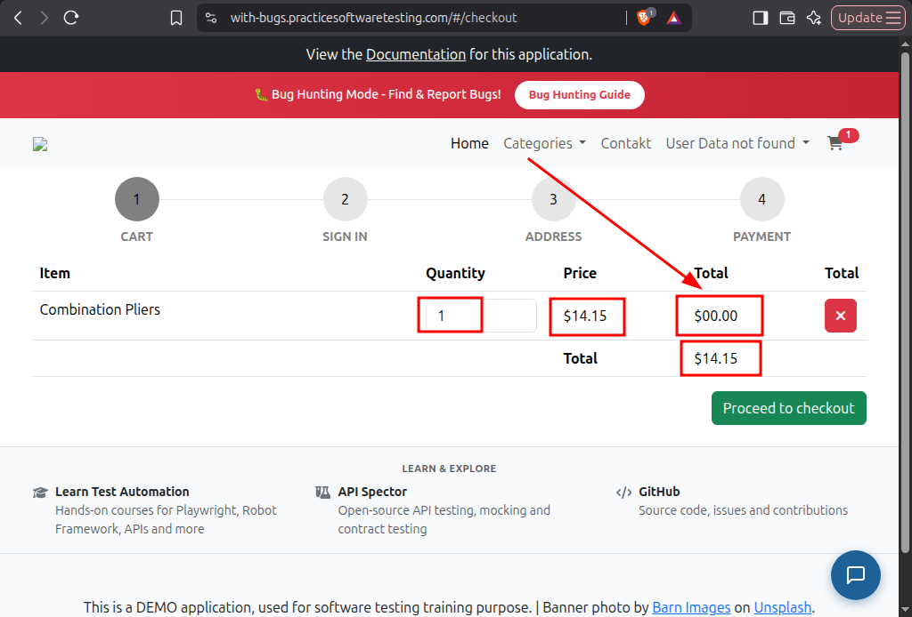

* Quantity = 2:
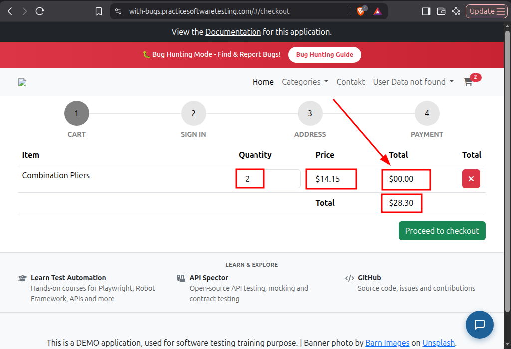

---

### BUG-023: Delete button in the cart does not remove products

- **Severity:** Medium  |  **Priority:** High  |  **Status:** Open
- **Requirement:** REQ-CRT-03  |  **Related test case:** [TC-027](./test-cases.md#tc-027-product-can-be-removed-from-the-cart)
- **Area:** Cart and favourites  |  **Build:** With-bugs Sprint 5  |  **Reproduces on clean:** No
- **Priority rationale:** A workaround exists (set the quantity to 0), but it is not obvious, and removing items is basic cart behaviour.

#### Steps
1. Add a product to the cart.
2. Open the cart.
3. Click the delete button of the product.

#### Expected
The product is removed and the totals update.

#### Actual
Nothing happens when the delete button is clicked. A product can only be removed by changing its quantity to 0.

#### Visual Evidence
[▶ Watch the clip](videos/cart_delete_button_unfunctional1.webp) · [MP4](videos/cart_delete_button_unfunctional1.mp4)

---

### BUG-024: Country and State fields are swapped on the Register page

- **Severity:** Medium  |  **Priority:** Medium  |  **Status:** Open
- **Requirement:** REQ-ACC-01  |  **Related test case:** [TC-030](./test-cases.md#tc-030-country-and-state-fields-collect-the-right-data)
- **Area:** Account  |  **Build:** With-bugs Sprint 5  |  **Reproduces on clean:** No

#### Steps
1. Open the Register page.
2. Enter a country in the Country field and a state in the State field.

#### Expected
Each field accepts what its label says.

#### Actual
The fields are swapped: the country must be entered in State, and the state in Country.

#### Visual Evidence
[▶ Watch the clip](videos/country_state_fields_swapped1.webp) · [MP4](videos/country_state_fields_swapped1.mp4)

---

### BUG-025: Date of birth over the age limit of 75 is accepted

- **Severity:** Medium  |  **Priority:** Medium  |  **Status:** Open
- **Requirement:** REQ-ACC-02  |  **Related test case:** [TC-031](./test-cases.md#tc-031-date-of-birth-above-the-age-limit-is-rejected)
- **Area:** Account  |  **Build:** With-bugs and clean Sprint 5  |  **Reproduces on clean:** Yes

#### Steps
1. Open the Register page.
2. Enter a date of birth with the year **1940** and valid data in the other fields.
3. Submit the form.

#### Expected
An error message is shown, because the app accepts users younger than 75 only.

#### Actual
The user is registered normally, with no error message.

#### Visual Evidence
With-bugs Sprint 5:
[▶ Watch the clip](videos/date_birth_faulted_with_bugs1.webp) · [MP4](videos/date_birth_faulted_with_bugs1.mp4)

Clean Sprint 5:
[▶ Watch the clip](videos/date_birth_faulted_clean_sprint1.webp) · [MP4](videos/date_birth_faulted_clean_sprint1.mp4)

---

### BUG-026: Invalid postcode is accepted on registration

- **Severity:** Medium  |  **Priority:** Medium  |  **Status:** Open
- **Requirement:** REQ-ACC-03  |  **Related test case:** [TC-032](./test-cases.md#tc-032-invalid-postcode-is-rejected)
- **Area:** Account  |  **Build:** With-bugs and clean Sprint 5  |  **Reproduces on clean:** Yes

#### Steps
1. Open the Register page.
2. Enter an invalid postcode (for example **hggtjtjg**) and valid data in the other fields.
3. Submit the form.

#### Expected
A validation error is shown.

#### Actual
The invalid postcode is accepted and the user is registered.

#### Visual Evidence
With-bugs Sprint 5:
[▶ Watch the clip](videos/postcode_faulted_with_bugs1.webp) · [MP4](videos/postcode_faulted_with_bugs1.mp4)

Clean Sprint 5:
[▶ Watch the clip](videos/postcode_faulted_clean_sprint1.webp) · [MP4](videos/postcode_faulted_clean_sprint1.mp4)

---

### BUG-027: "User Data not found" replaces the account tab after login

- **Severity:** Medium  |  **Priority:** High  |  **Status:** Open
- **Requirement:** REQ-ACC-04  |  **Related test case:** [TC-034](./test-cases.md#tc-034-header-shows-the-users-name-or-my-account-after-login)
- **Area:** Account  |  **Build:** With-bugs Sprint 5  |  **Reproduces on clean:** No
- **Priority rationale:** The text appears for every user after every login, so it hurts the first impression of the whole application.

#### Steps
1. Log in with valid credentials.
2. Look at the navigation bar.

#### Expected
The Log in tab is replaced by "My account" or the user's name.

#### Actual
The Log in tab disappears and a tab named "User Data not found" appears.

#### Visual Evidence
[▶ Watch the clip](videos/User_Data_not_found1.webp) · [MP4](videos/User_Data_not_found1.mp4)

---

### BUG-028: SQL injection payload in the email field bypasses the login

- **Severity:** Critical  |  **Priority:** High  |  **Status:** Open
- **Requirement:** REQ-ACC-09  |  **Related test case:** [TC-043](./test-cases.md#tc-043-injection--unicode-stress-test)
- **Area:** Account  |  **Build:** With-bugs Sprint 5  |  **Reproduces on clean:** No
- **Priority rationale:** An attacker can log in without valid credentials, so this must be fixed before anything else.

#### Steps
1. Register with valid credentials.
2. Go to the login page and enter this payload **'OR'1'='1** in the email field.
3. Enter the right password.
4. Click the "**Login**" button.

#### Expected
The user is not logged in, and the validation message "Invalid email or password" appears.

#### Actual
The user is logged in successfully: the SQL injection payload bypasses the authentication.

#### Visual Evidence
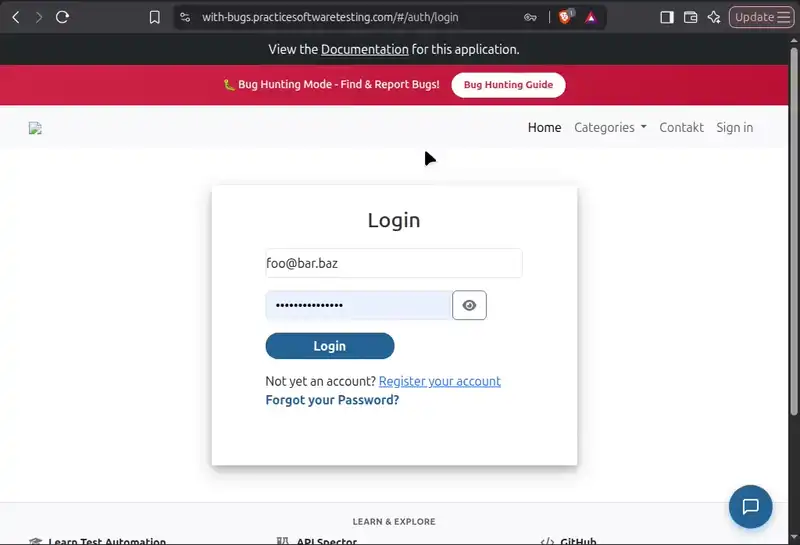

[Full-quality MP4](videos/sql_injection1.mp4)

---

### BUG-029: Server returns 500 Internal Server Error when submitting SQL-injection-style payload ';-- in login email field

- **Severity:** High  |  **Priority:** High  |  **Status:** Open
- **Requirement:** REQ-ACC-09  |  **Related test case:** [TC-043](./test-cases.md#tc-043-injection--unicode-stress-test)
- **Area:** Account  |  **Build:** With-bugs Sprint 5  |  **Reproduces on clean:** No

#### Steps
1. Go to login page.
2. Enter any value containing ';-- in the email field (e.g., foo';--@bar.baz).
3. Click Login.
4. Observe console/network tab.

#### Expected
- HTTP 400 Bad Request with clear message (“Invalid email or password”).
- No server crash or stack trace exposed.

#### Actual
- HTTP 500 Internal Server Error repeated multiple times.
- Suggests lack of input sanitization/validation.
- Possible SQL vector even if not exploited.

#### Visual Evidence
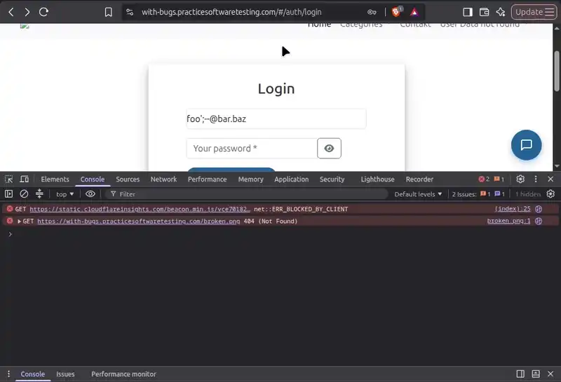

[Full-quality MP4](videos/server_returns_500_internal_server_error1.mp4)

#### Technical Context
- DevTools Console logs:
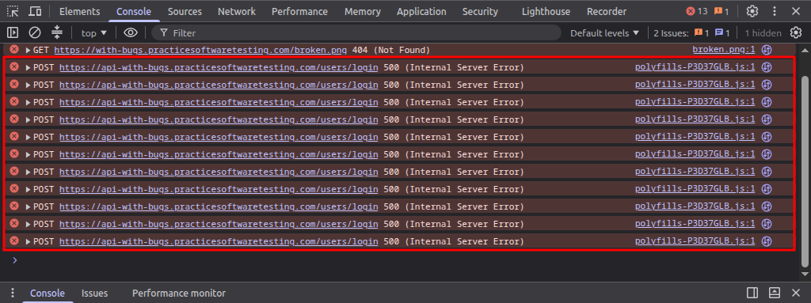

* DevTools Network tab:
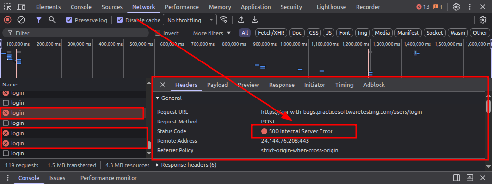

---

### BUG-030: Capitalised email address on registration shows "E-mail format is invalid" instead of the duplicate-email message

- **Severity:** Medium  |  **Priority:** Medium  |  **Status:** Open
- **Requirement:** REQ-ACC-11  |  **Related test case:** [TC-045](./test-cases.md#tc-045-register-email-case-sensitivity-foobarbaz-vs-foobarbaz)
- **Area:** Account  |  **Build:** With-bugs Sprint 5  |  **Reproduces on clean:** No

#### Steps
1. Pre-register with any email (e.g., foo@bar.baz).
2. Go to the registration page.
3. Enter **Foo@bar.baz** in the Email field (capitalise some or all of the characters).
4. Fill the other fields with valid data.
5. Click the "**Register**" button.

#### Expected
- Registration is refused.
- The message "A customer with this email address already exists" appears.

#### Actual
- Registration did not complete; the user remained on the Register page.
- The message "E-mail format is invalid" appeared, instead of the expected duplicate-email message.
- No duplicate account was created.

#### Visual Evidence
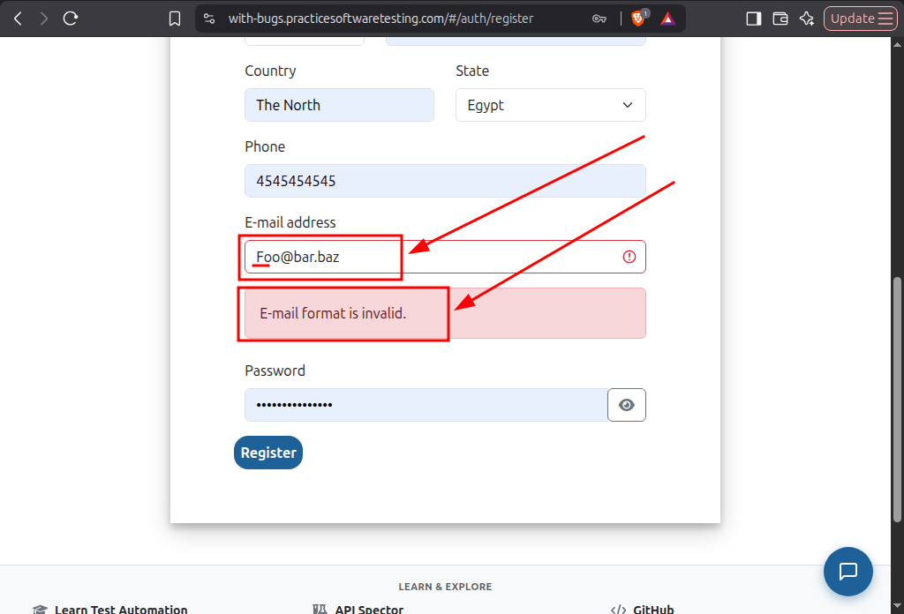

#### Notes
The login accepts the capitalised email (TC-045), so the two forms treat the same address differently.

---

### BUG-031: Registering with an existing email returns a password-hint message

- **Severity:** Medium  |  **Priority:** Medium  |  **Status:** Open
- **Requirement:** REQ-ACC-11  |  **Related test case:** [TC-048](./test-cases.md#tc-048-register-with-an-already-registered-email)
- **Area:** Account  |  **Build:** With-bugs Sprint 5  |  **Reproduces on clean:** No

#### Steps
1. Pre-register with any email (e.g., foo@bar.baz).
2. Go to registration page.
3. Enter **foo@bar.baz** in the Email field.
4. Fill the other fields with valid data.
5. Click the "**Register**" button.
6. Observe the message shown.
7. Repeat steps 1–5 on the clean sprint 5 and compare.

#### Expected
Registration is blocked and the message ("A customer with this email address already exists.") is displayed.

#### Actual
Registration is blocked, but the message displayed is: ("User already registered - Your password hint is: Name of your cat!").

#### Impact
- Users receive no actionable guidance on what to do next (e.g. login or recover the password); they are told about a hint for a feature they never set up.

#### Visual Evidence
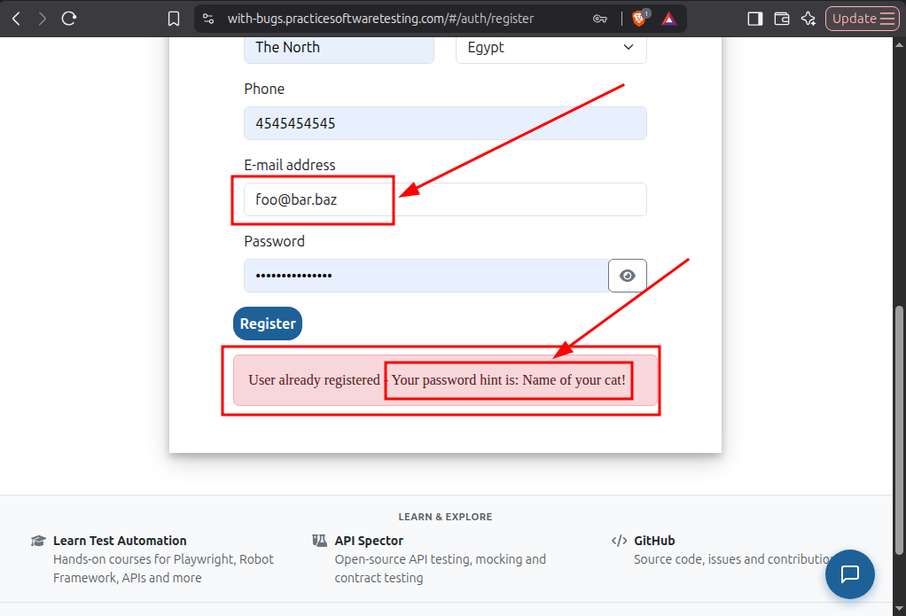

---

### BUG-032: Update Profile returns "Resource not found"

- **Severity:** High  |  **Priority:** High  |  **Status:** Open
- **Requirement:** REQ-ACC-05  |  **Related test case:** [TC-049](./test-cases.md#tc-049-update-profile)
- **Area:** Account  |  **Build:** With-bugs Sprint 5  |  **Reproduces on clean:** No

#### Steps
1. Log in.
2. Open the profile page.
3. Edit any field.
4. Click Update Profile.

#### Expected
A success message appears and the change is saved.

#### Actual
The error "Resource not found" appears.

#### Visual Evidence
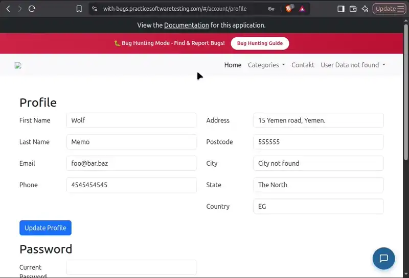

[Full-quality MP4](videos/update_profile_error1.mp4)

---

### BUG-033: Changing the password while logged in locks the user out

- **Severity:** Critical  |  **Priority:** High  |  **Status:** Open
- **Requirement:** REQ-ACC-06  |  **Related test case:** [TC-050](./test-cases.md#tc-050-change-password-while-logged-in)
- **Area:** Account  |  **Build:** With-bugs Sprint 5  |  **Reproduces on clean:** No

#### Steps
1. Log in.
2. Open the change password option and set a new password.
3. Log out.
4. Log in with the new password.

#### Expected
The user can log in with the new password.

#### Actual
The password is changed to a value the user did not choose or know, so the account becomes inaccessible.

#### Visual Evidence
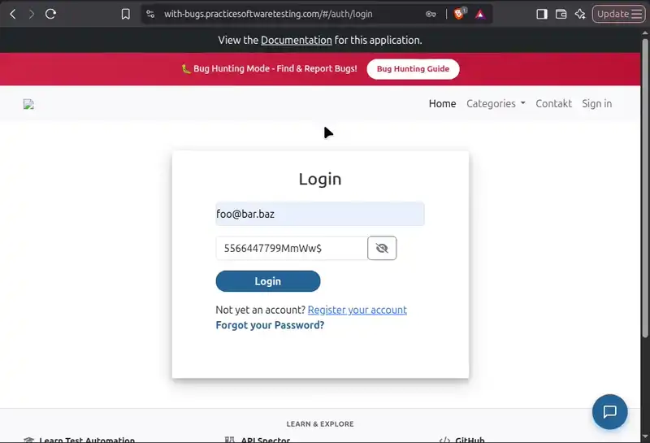

[Full-quality MP4](videos/logged_in_changing_password_faulted1.mp4)

---

### BUG-034: Resetting a forgotten password locks the user out

- **Severity:** Critical  |  **Priority:** High  |  **Status:** Open
- **Requirement:** REQ-ACC-07  |  **Related test case:** [TC-051](./test-cases.md#tc-051-reset-a-forgotten-password)
- **Area:** Account  |  **Build:** With-bugs and clean Sprint 5  |  **Reproduces on clean:** Yes

#### Steps
1. Open the Forgot your Password? page.
2. Follow the reset flow and set a new password.
3. Log in with the new password.

#### Expected
The user can log in with the new password.

#### Actual
The password is changed to a value the user did not choose or know, so the account becomes inaccessible.

#### Visual Evidence
- With-bugs Sprint 5:
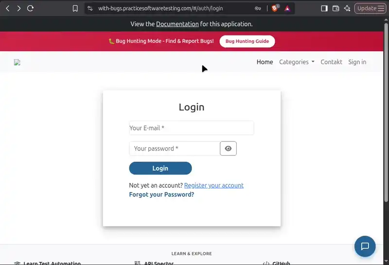

[Full-quality MP4](videos/forogt_password_faulted_with_bugs1.mp4)

* Clean Sprint 5:
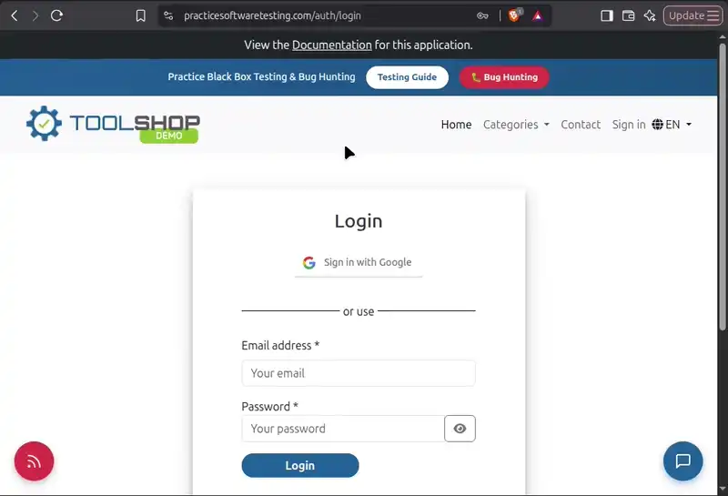

[Full-quality MP4](videos/forogt_password_faulted_clean_sprint1.mp4)

---

### BUG-035: City field in the profile page shows "City not found" instead of the user's city

- **Severity:** Medium  |  **Priority:** Medium  |  **Status:** Open
- **Requirement:** REQ-ACC-12  |  **Related test case:** [TC-052](./test-cases.md#tc-052-check-the-layout-and-data-accuracy-inside-the-profile-page)
- **Area:** Account  |  **Build:** With-bugs Sprint 5  |  **Reproduces on clean:** No

#### Steps
1. Open the profile page after logging in successfully.
2. Check the City field inside the Profile section.

#### Expected
The field is filled with the city the user selected during registration.

#### Actual
Field is not filled with the city the user selected during registration; instead, the phrase "City not found" is displayed.

#### Visual Evidence
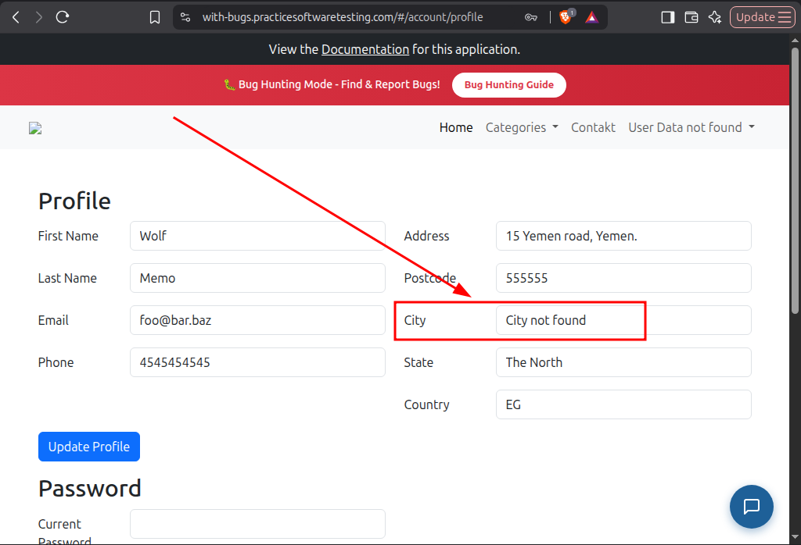

---

### BUG-036: Step indicator stops working at the final checkout step (Payment)

- **Severity:** Medium  |  **Priority:** Medium  |  **Status:** Open
- **Requirement:** REQ-CHK-01  |  **Related test case:** [TC-053](./test-cases.md#tc-053-move-through-the-checkout-steps)
- **Area:** Checkout  |  **Build:** With-bugs and clean Sprint 5  |  **Reproduces on clean:** Yes

#### Steps
1. Add a product to the cart.
2. Open the cart and proceed to checkout.
3. Go through the checkout steps till you reach to the final step "payment method".
4. Use the step indicator to go back to a previous step.

#### Expected
Step indicator is functional and user can step back to any step without having to use the browser back button and start all the steps from the very beginning.

#### Actual
Step indicator is non-functional and user has to use the browser back button and go through all the steps again from the very beginning.

#### Visual Evidence
- With-bugs Sprint 5:
[▶ Watch the clip](videos/step_indicator_faulted_with_bugs1.webp) · [MP4](videos/step_indicator_faulted_with_bugs1.mp4)

* Clean Sprint 5:
[▶ Watch the clip](videos/step_indicator_faulted_clean_sprint1.webp) · [MP4](videos/step_indicator_faulted_clean_sprint1.mp4)

---

### BUG-037: Continue button in the Billing Address step has no label

- **Severity:** Low  |  **Priority:** Medium  |  **Status:** Open
- **Requirement:** REQ-CHK-02  |  **Related test case:** [TC-054](./test-cases.md#tc-054-layout-through-the-checkout-steps-is-clean-and-everything-is-functional)
- **Area:** Checkout  |  **Build:** With-bugs Sprint 5  |  **Reproduces on clean:** No
- **Priority rationale:** The empty button sits in the middle of the purchase flow, so it is worth fixing soon even though it is cosmetic.

#### Steps
1. Add a product to the cart and proceed to checkout.
2. Reach the Billing Address step.
3. Look at the continue button.

#### Expected
The button is labelled "Proceed to checkout".

#### Actual
The button is empty.

#### Visual Evidence
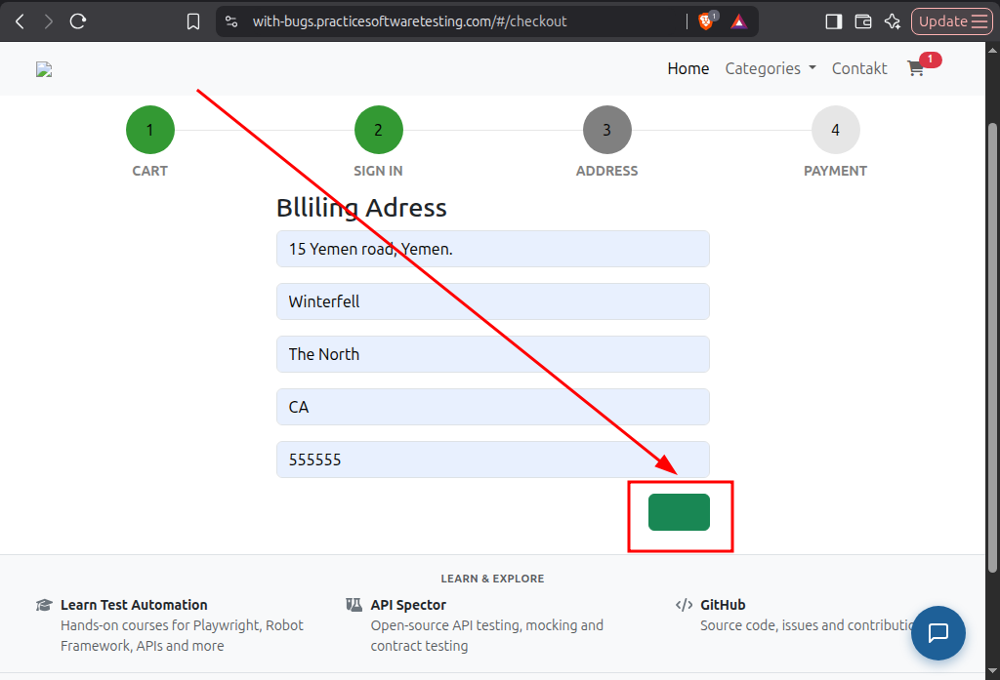

---

### BUG-038: Postcode field in the Billing Address is pre-filled with "missing value"

- **Severity:** Medium  |  **Priority:** Medium  |  **Status:** Open
- **Requirement:** REQ-CHK-02  |  **Related test case:** [TC-055](./test-cases.md#tc-055-billing-address-is-pre-filled-with-valid-values)
- **Area:** Checkout  |  **Build:** With-bugs Sprint 5  |  **Reproduces on clean:** No

#### Steps
1. Add a product to the cart and proceed to checkout.
2. Reach the Billing Address step.
3. Check the Postcode field.

#### Expected
The postcode field is pre-filled with the valid data.

#### Actual
All fields are pre-filled with valid data except Postcode, which contains the text "missing value".

#### Visual Evidence
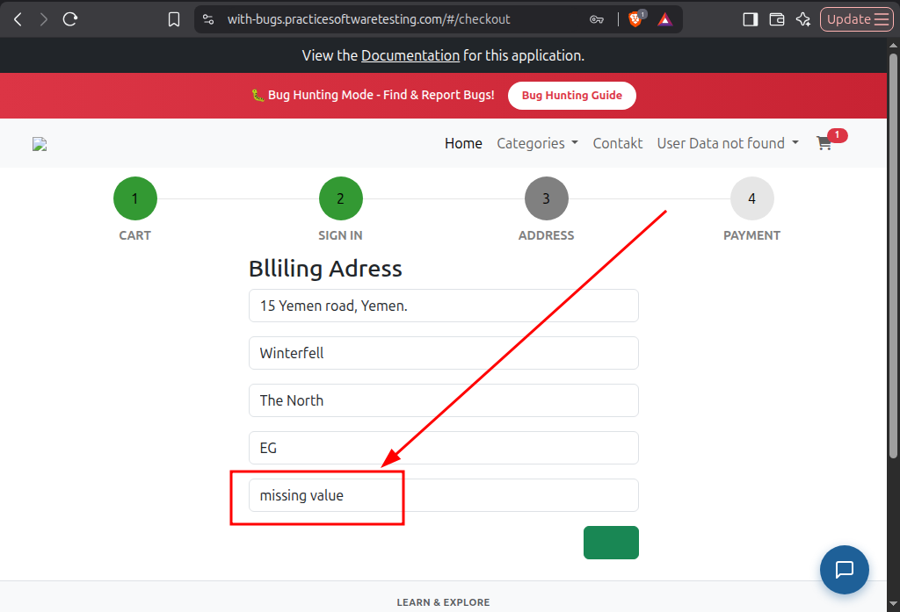

---

### BUG-039: House number field in the Billing Address is not pre-filled (clean Sprint 5)

- **Severity:** Medium  |  **Priority:** Medium  |  **Status:** Open
- **Requirement:** REQ-CHK-02  |  **Related test case:** [TC-055](./test-cases.md#tc-055-billing-address-is-pre-filled-with-valid-values)
- **Area:** Checkout  |  **Build:** Clean Sprint 5  |  **Reproduces on clean:** Clean-only

#### Steps
1. Open the clean Sprint 5.
2. Add a product to the cart and proceed to checkout.
3. Reach the Billing Address step.
4. Check the House number field.

#### Expected
The House number field is pre-filled with the valid data.

#### Actual
All fields are pre-filled with valid data except House number, which is empty.

#### Visual Evidence
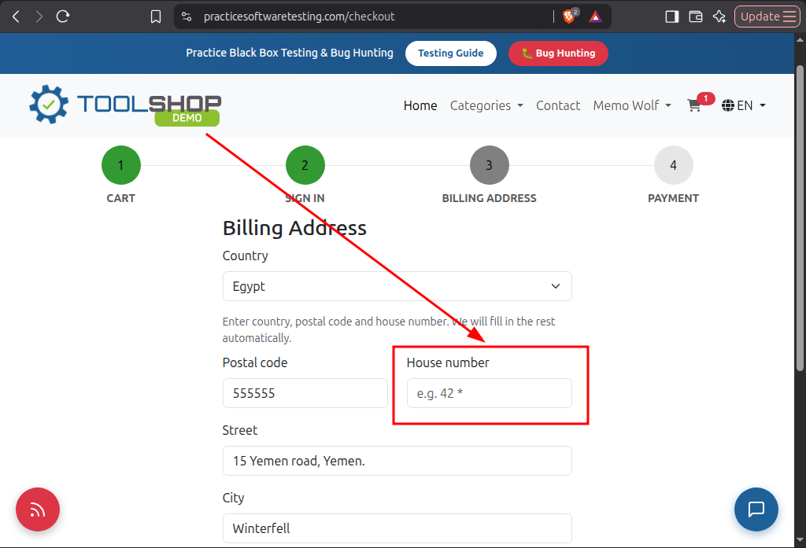

---

### BUG-040: Account name and number are required for every payment method

- **Severity:** Medium  |  **Priority:** High  |  **Status:** Open
- **Requirement:** REQ-CHK-03  |  **Related test case:** [TC-056](./test-cases.md#tc-056-each-payment-method-is-practical-and-functional)
- **Area:** Checkout  |  **Build:** With-bugs Sprint 5  |  **Reproduces on clean:** No
- **Priority rationale:** Customers can still pay by typing any data, but the payment step is business critical and accepts invalid data.

#### Steps
1. Reach the Payment step of the checkout.
2. Select Cash on Delivery.
3. Try to continue without filling any field.
4. Fill both fields with any data and continue.

#### Expected
Every payment method is usable and asks only for the details it needs.

#### Actual
"Your Account name" and "Your Account number" are shown and required for every method, even Cash on Delivery, and any data (even invalid) is accepted.

#### Visual Evidence
[▶ Watch the clip](videos/payment_methods_faulted1.webp) · [MP4](videos/payment_methods_faulted1.mp4)

#### Technical Context
**A comparison of the code dynamics for both versions when changing the payment method**:
- Clean Sprint 5:
[▶ Watch the clip](videos/DevTools_elements_payment_methods_clean_sprint1.webp) · [MP4](videos/DevTools_elements_payment_methods_clean_sprint1.mp4)

* With-bugs Sprint 5:
[▶ Watch the clip](videos/DevTools_elements_payment_methods_with_bugs1.webp) · [MP4](videos/DevTools_elements_payment_methods_with_bugs1.mp4)

---

### BUG-041: Normal purchase creates no invoice and shows no invoice number

- **Severity:** High  |  **Priority:** High  |  **Status:** Open
- **Requirement:** REQ-CHK-04, REQ-INV-01  |  **Related test case:** [TC-057](./test-cases.md#tc-057-purchase-confirmation-shows-an-invoice-number), [TC-058](./test-cases.md#tc-058-invoice-is-listed-after-a-normal-purchase)
- **Area:** Invoices  |  **Build:** With-bugs and clean Sprint 5  |  **Reproduces on clean:** Yes

#### Steps
1. Complete a purchase from the cart page.
2. Read the confirmation.
3. Open My account, then My invoices.

#### Expected
The confirmation shows an invoice number, and the invoice appears in the list.

#### Actual
No invoice number is shown and the invoice is not added. Only purchases made through the Chat Assistant create an invoice.

#### Visual Evidence
- With-bugs Sprint 5:
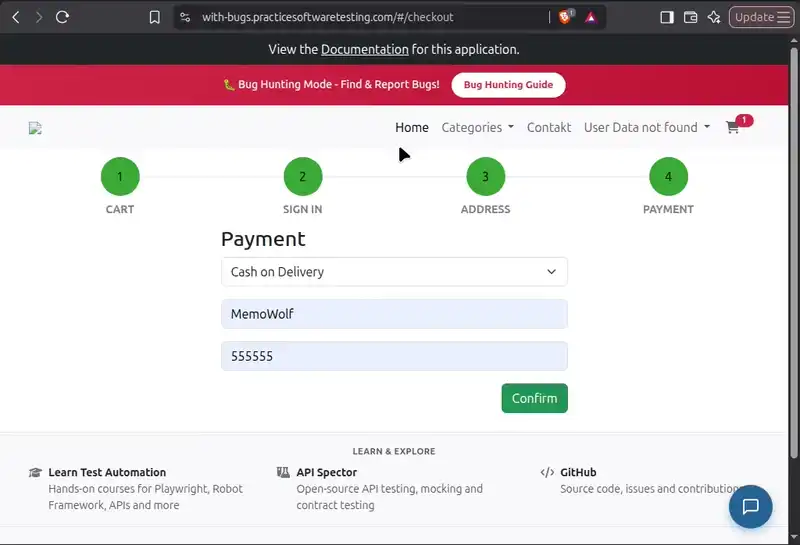

[Full-quality MP4](videos/no_invoice_number_with_bugs1.mp4)

* Clean Sprint 5:
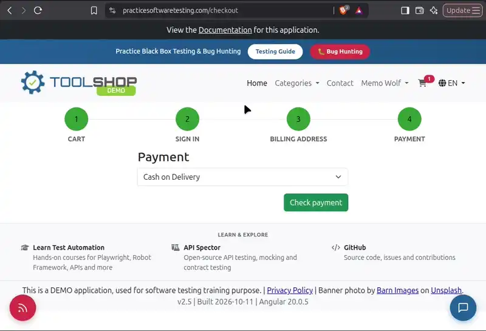

[Full-quality MP4](videos/no_invoice_number_clean_sprint1.mp4)

---

### BUG-042: Invoice created through the Chat Assistant shows "Method not found" and "undefined" fields

- **Severity:** Medium  |  **Priority:** Medium  |  **Status:** Open
- **Requirement:** REQ-INV-02  |  **Related test case:** [TC-060](./test-cases.md#tc-060-invoice-details-are-complete)
- **Area:** Invoices  |  **Build:** With-bugs Sprint 5  |  **Reproduces on clean:** No

#### Steps
1. Complete a purchase using the Chat Assistant (fill in the billing and payment data).
2. Open My account, then My invoices.
3. Open the invoice details.

#### Expected
Invoice details are complete.

#### Actual
- The Payment Method defined as "Method not found".
- Billing Address, Postcode, and State fields are filled with "undefined".

#### Visual Evidence
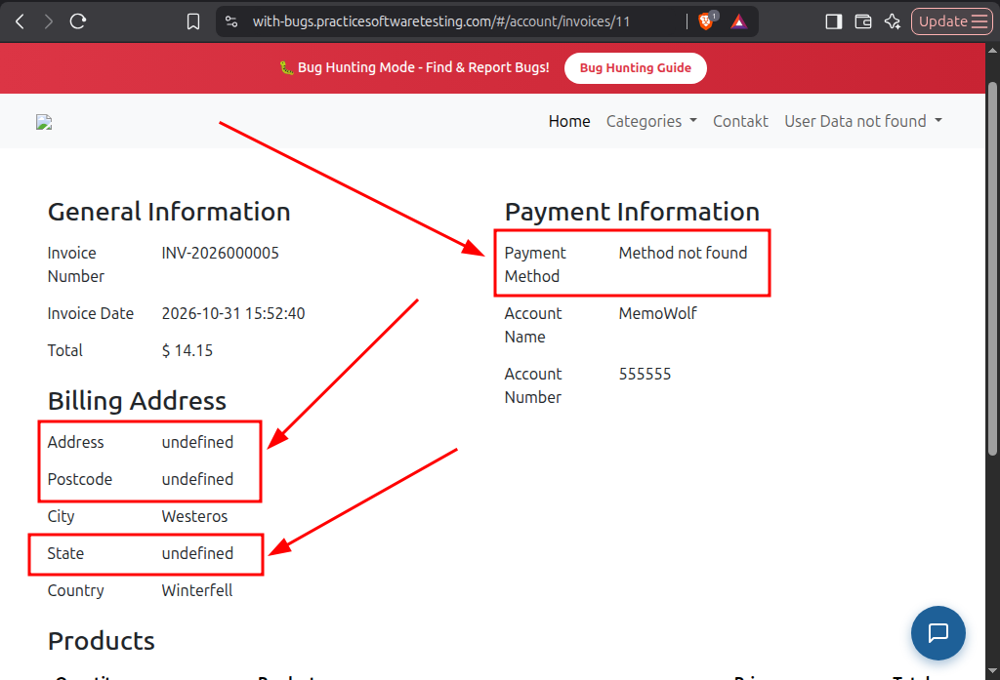

---

### BUG-043: Purchasing through Chat Assistant encountered an error on the clean Sprint 5

- **Severity:** High  |  **Priority:** High  |  **Status:** Open
- **Requirement:** REQ-CHT-05, REQ-INV-02, REQ-INV-03  |  **Related test case:** [TC-059](./test-cases.md#tc-059-purchase-through-the-chat-assistant-creates-an-invoice), [TC-060](./test-cases.md#tc-060-invoice-details-are-complete), [TC-072](./test-cases.md#tc-072-purchase-through-the-chat-with-valid-data)
- **Area:** Chat Assistant  |  **Build:** Clean Sprint 5  |  **Reproduces on clean:** Clean-only

#### Steps
1. Complete a purchase using the Chat Assistant (fill in the billing and payment data).

#### Expected
The purchase is confirmed with an invoice number.

#### Actual
- Purchasing through Chat Assistant encountered an error, and the process didn't complete.

#### Visual Evidence
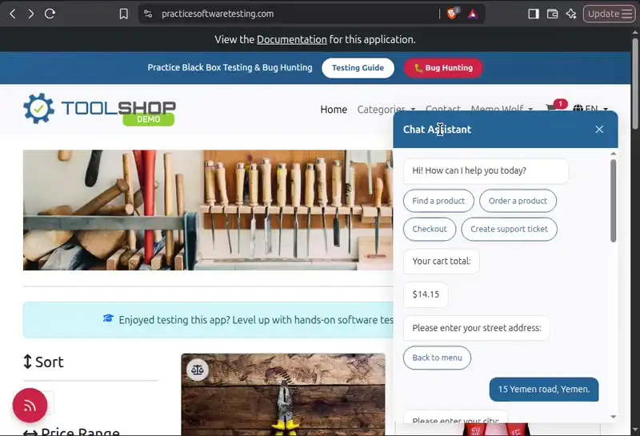

[Full-quality MP4](videos/clean_sprint_purchasing_through_chat_assistant_faulted1.mp4)

---

### BUG-044: Contact subject options have 3 visual errors

- **Severity:** Low  |  **Priority:** Medium  |  **Status:** Open
- **Requirement:** REQ-CNT-01  |  **Related test case:** [TC-062](./test-cases.md#tc-062-check-the-layout-inside-the-contact-page)
- **Area:** Contact  |  **Build:** With-bugs Sprint 5  |  **Reproduces on clean:** No
- **Priority rationale:** Error texts in a form dropdown are visible to every visitor, although valid subjects can still be chosen.

#### Steps
1. Open the Contact page.
2. Check the "**Subject**" options.

#### Expected
All of the subjects visible, clean, and readable.

#### Actual
3 visual errors:
1. "**Return**" is very small, smaller than the other options and hard to read.
2. "**Error 101: Subject not found**".
3. "**Error 202: Translation error**".

#### Visual Evidence
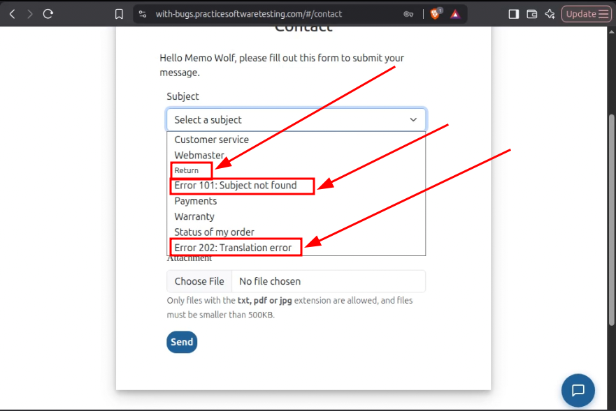

#### Technical Context
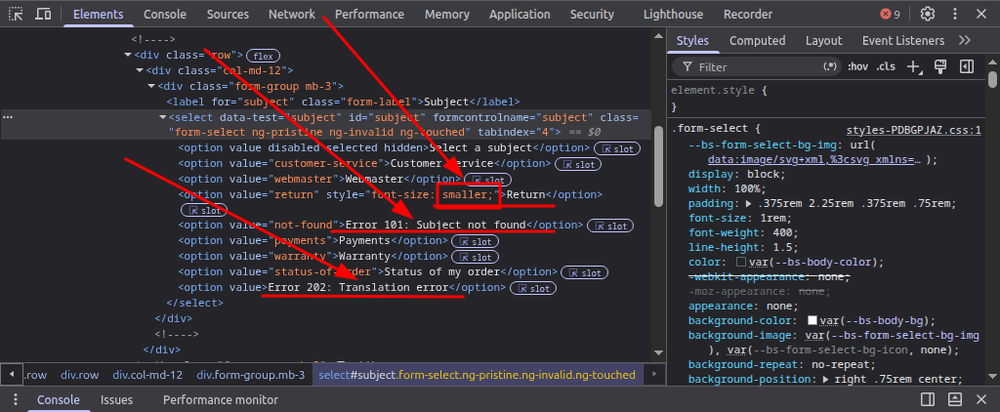

---

### BUG-045: Contact attachment label does not match the behaviour (with-bugs build)

- **Severity:** Medium  |  **Priority:** Medium  |  **Status:** Open
- **Requirement:** REQ-CNT-02  |  **Related test case:** [TC-063](./test-cases.md#tc-063-attachment-rules-match-the-label-with-bugs-build)
- **Area:** Contact  |  **Build:** With-bugs Sprint 5  |  **Reproduces on clean:** No

#### Steps
1. Open the Contact page and read the label under the attachment field (.pdf and .jpg, maximum 500 KB).
2. Attach a .pdf or .jpg file.
3. Attach a .txt file that sizes more than 500 KB.

#### Expected
A .txt or .pdf or .jpg file up to 500 KB is accepted, and larger files are rejected.

#### Actual
Only .txt files are accepted (a .pdf or .jpg file gives "The file extension is incorrect, we only accept txt files."), and the above 500 KB file is accepted with no error.

#### Visual Evidence
- .jpg file error:
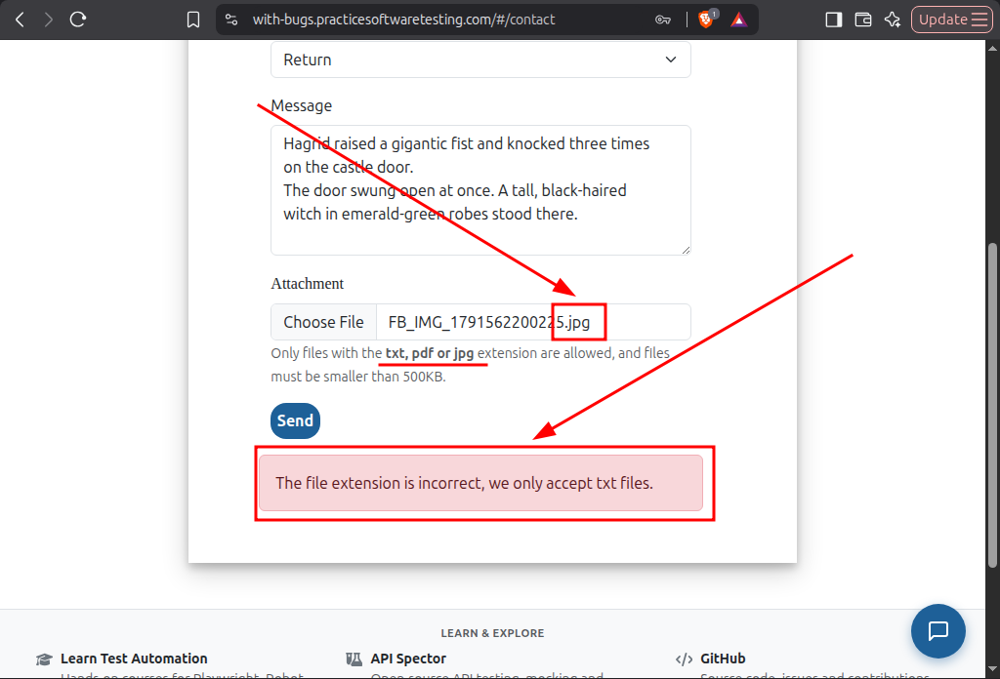

* .pdf file error:
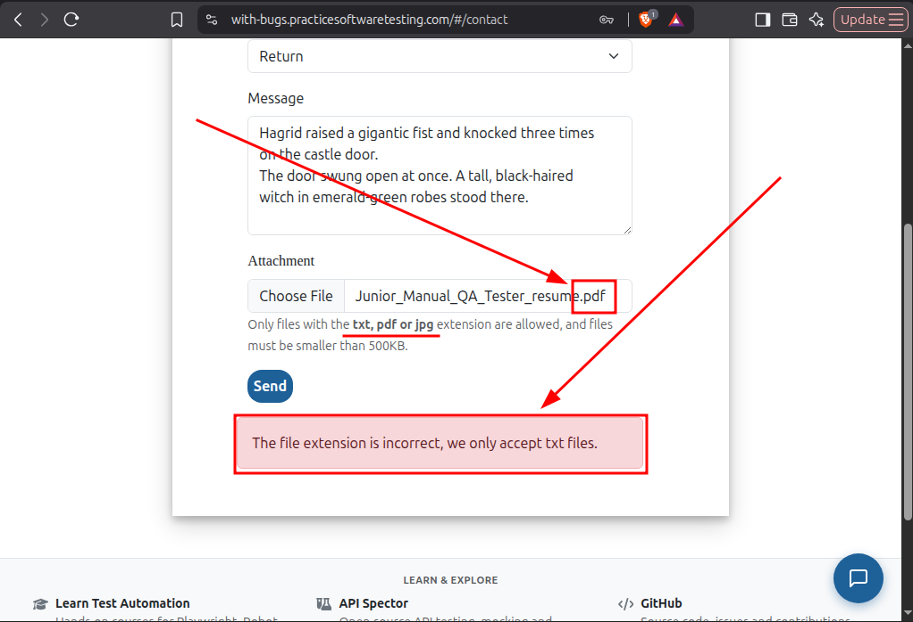

- .txt file larger than 500 KB:
[▶ Watch the clip](videos/contact_attachment_txt_above_500_kb1.webp) · [MP4](videos/contact_attachment_txt_above_500_kb1.mp4)

---

### BUG-046: Attachment rule "only .txt files, 0 KB" makes the field unusable (clean build)

- **Severity:** Medium  |  **Priority:** Medium  |  **Status:** Open
- **Requirement:** REQ-CNT-02  |  **Related test case:** [TC-064](./test-cases.md#tc-064-attachment-rule-is-usable-clean-build)
- **Area:** Contact  |  **Build:** Clean Sprint 5  |  **Reproduces on clean:** Clean-only

#### Steps
1. Open the Contact page and read the label under the attachment field.
2. Attach an empty .txt file.
3. Attach a 1 KB .txt file, then a 600 KB .txt file.
4. Try to select a .pdf or .jpg file.

#### Expected
A reasonable rule that lets users attach a file.

#### Actual
The label says "Only files with the txt extension are allowed, and files must be 0kb." The empty file is accepted, both non-empty files are rejected with "File should be empty.", and .pdf and .jpg files are not selectable. Only an empty file can ever be attached.

#### Visual Evidence
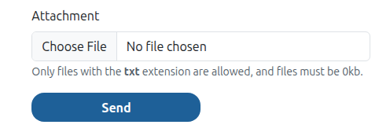

---

### BUG-047: Message Details button opens the most recent message instead of the selected one

- **Severity:** High  |  **Priority:** Medium  |  **Status:** Open
- **Requirement:** REQ-CNT-03  |  **Related test case:** [TC-065](./test-cases.md#tc-065-check-the-functionality-and-the-layout-inside-the-my-messages-tab)
- **Area:** Contact  |  **Build:** With-bugs Sprint 5  |  **Reproduces on clean:** No
- **Priority rationale:** Users cannot read earlier messages, but contact messages are a secondary feature, so the fix can follow the checkout issues.

#### Steps
1. Log in after registering with valid credentials.
2. Open the "**Contact**" page.
3. Attach a valid file and submit the form.
4. Repeat the previous step for one or two more times.
5. Go to the "**My messages**" section inside My account tab "or User Data not found as it named".
6. Click the "**Details**" button of each message.

#### Expected
Clicking any message details button opens the details of the selected message.

#### Actual
Clicking the details button for any message opens the details of the most recently sent message, rather than the details of the selected message.

#### Visual Evidence
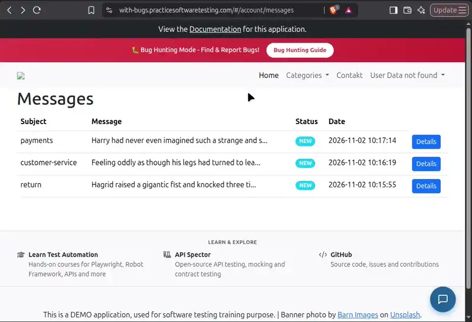

[Full-quality MP4](videos/message_details_button_faulted1.mp4)

---

### BUG-048: Product images do not show when searching for products via the chat assistant

- **Severity:** Low  |  **Priority:** Medium  |  **Status:** Open
- **Requirement:** REQ-CHT-03  |  **Related test case:** [TC-068](./test-cases.md#tc-068-search-for-an-existing-product-through-the-chat)
- **Area:** Chat Assistant  |  **Build:** With-bugs Sprint 5  |  **Reproduces on clean:** No
- **Priority rationale:** The problem is cosmetic, but images help customers choose products in the chat.

#### Steps
1. Open the chat.
2. Ask for a product that exists in the catalog (use a name taken from the product list).

#### Expected
Search result images are displayed.

#### Actual
Search result images are not displayed.

#### Visual Evidence
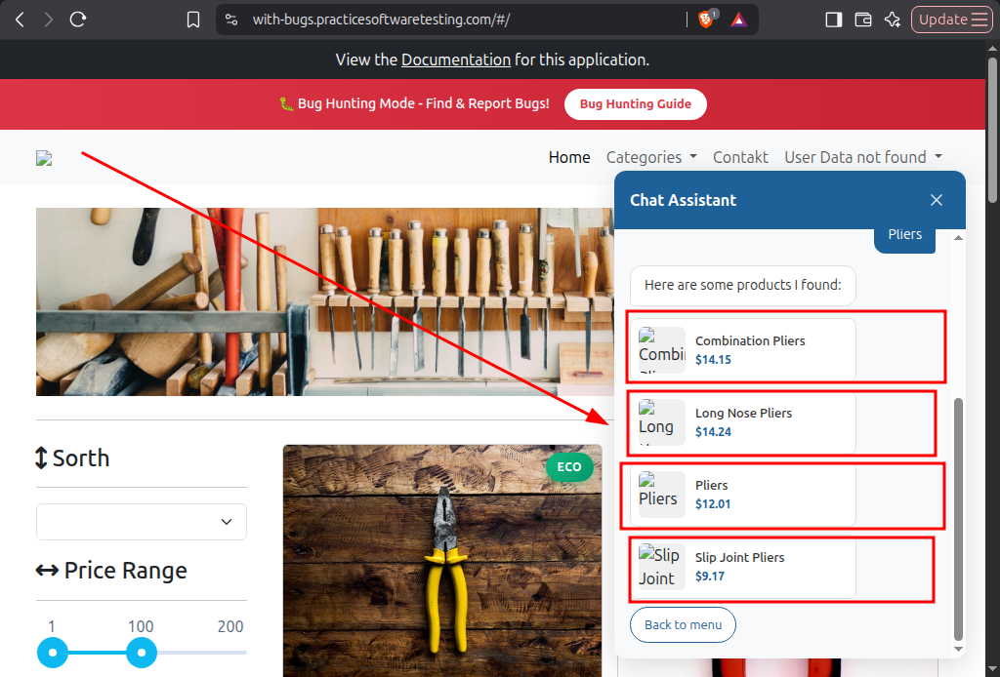

---

### BUG-049: Cart does not show the product name and price after adding a product through the Chat Assistant

- **Severity:** Medium  |  **Priority:** Medium  |  **Status:** Open
- **Requirement:** REQ-CHT-04  |  **Related test case:** [TC-070](./test-cases.md#tc-070-add-a-product-to-the-cart-through-the-chat)
- **Area:** Chat Assistant  |  **Build:** With-bugs Sprint 5  |  **Reproduces on clean:** No

#### Steps
1. Open the chat.
2. Ask the assistant to add an existing product to the cart.
3. Open the cart page.

#### Expected
The assistant confirms the action, and the cart shows the product with the correct quantity and price.

#### Actual
The assistant confirms the action, but the cart doesn't show the name and price.

#### Visual Evidence
[▶ Watch the clip](videos/adding_to_cart_through_chat_faulted1.webp) · [MP4](videos/adding_to_cart_through_chat_faulted1.mp4)

---

### BUG-050: Re-adding a product already in the cart through the Chat Assistant replaces the quantity instead of increasing it

- **Severity:** Medium  |  **Priority:** Medium  |  **Status:** Open
- **Requirement:** REQ-CHT-04  |  **Related test case:** [TC-071](./test-cases.md#tc-071-re-adding-a-product-already-in-the-cart-to-the-cart-via-chat)
- **Area:** Chat Assistant  |  **Build:** With-bugs Sprint 5  |  **Reproduces on clean:** No

#### Steps
1. Log in (if the assistant requires it).
2. Open the chat.
3. Ask the assistant to add an existing product to the cart.
4. Redo the previous step.
5. Open the cart page.
6. Check the quantity and price values; they should be increased.

#### Expected
The assistant confirms the action, and the cart shows the product with the new increased correct quantity and price.

#### Actual
- The assistant confirms the action, and the cart shows the product but not with the new increased correct quantity and price.
- The old process has been replaced by the new one, so, the cart only shows the new quantity and price.

#### Visual Evidence
[▶ Watch the clip](videos/readding_product_already_in_cart_to_cart_via_chat_not_show_new_increased_correct_quantity_and_price1.webp) · [MP4](videos/readding_product_already_in_cart_to_cart_via_chat_not_show_new_increased_correct_quantity_and_price1.mp4)

---

### BUG-051: Chat Assistant shows a generic error instead of asking for valid data after a purchase attempt with invalid data

- **Severity:** Medium  |  **Priority:** Medium  |  **Status:** Open
- **Requirement:** REQ-CHT-05  |  **Related test case:** [TC-073](./test-cases.md#tc-073-purchase-through-the-chat-with-missing-or-invalid-data)
- **Area:** Chat Assistant  |  **Build:** With-bugs and clean Sprint 5  |  **Reproduces on clean:** Yes

#### Steps
1. Log in.
2. Open the chat and ask to buy an existing product.
3. Give incomplete or invalid details (for example a blank postcode, or letters in the account number).

#### Expected
The assistant refuses, asks for correct data, and creates no order.

#### Actual
The assistant refuses, shows an error ("There was an error processing your order: Something went wrong"), and creates no order.

#### Visual Evidence
[▶ Watch the clip](videos/purchasing_through_chat_using_invalid_data_shows_misleading_error1.webp) · [MP4](videos/purchasing_through_chat_using_invalid_data_shows_misleading_error1.mp4)

---

### BUG-052: Keyboard focus order is wrong or skips interactive elements

- **Severity:** Medium  |  **Priority:** Medium  |  **Status:** Open
- **Requirement:** REQ-KBD-01  |  **Related test case:** [TC-082](./test-cases.md#tc-082-keyboard-focus-order-is-logical-and-reaches-every-interactive-element)
- **Area:** Keyboard Accessibility  |  **Build:** With-bugs Sprint 5  |  **Reproduces on clean:** Partly (3 of the 7 items also occur on clean)

#### Steps
1. Click outside the content (or press Esc) to ensure no field is focused.
2. Press the Tab key repeatedly, observing where focus lands after each press.
3. Note the sequence of focused elements.
4. Repeat the process through the entire application.

#### Expected
- Focus moves in a logical visual order.
- No interactive element is skipped; no non-interactive element receives focus.

#### Actual & Visual Evidence
- With bugs:
  - On the contact page, the focus starts from the subject field if the user was logged in, and from the first name field if the user was not logged in, and not starting from the top of the page.
  [▶ Watch the clip](videos/taborder_contact_page_faulted_with_bugs1.webp) · [MP4](videos/taborder_contact_page_faulted_with_bugs1.mp4)

  - On the login page, the focus starts from the email field going to the login field, and it does not follow the correct path.
  [▶ Watch the clip](videos/taborder_login_page_faulted_with_bugs1.webp) · [MP4](videos/taborder_login_page_faulted_with_bugs1.mp4)

  - On the registration page, the focus starts with the first name field, then moves to the last name field, then skips the date of birth, then goes through the rest of the fields up to the email address field, then skips the password field and goes directly to the registration button.
  [▶ Watch the clip](videos/taborder_registration_page_faulted_with_bugs1.webp) · [MP4](videos/taborder_registration_page_faulted_with_bugs1.mp4)

  - When using the Chat Assistant to find products, focus skips over the results completely without capturing them, and user cannot click on any of them using only the keyboard.
  [▶ Watch the clip](videos/taborder_chat_finding_products_faulted_with_bugs1.webp) · [MP4](videos/taborder_chat_finding_products_faulted_with_bugs1.mp4)

* Both Sprints:
  - Focus completely skips the Sign out option in the navigation bar.
  [▶ Watch the clip](videos/taborder_sign_out_both_sprints1.webp) · [MP4](videos/taborder_sign_out_both_sprints1.mp4)

  - Focus completely skips the delete button inside the cart.
  [▶ Watch the clip](videos/taborder_cart_delete_button_both_sprints1.webp) · [MP4](videos/taborder_cart_delete_button_both_sprints1.mp4)

  - Focus completely skips the step indicator inside the checkout steps.
  [▶ Watch the clip](videos/taborder_skips_step_indicator_both_sprints1.webp) · [MP4](videos/taborder_skips_step_indicator_both_sprints1.mp4)

---

### BUG-053: Chat Assistant exit button has no visible focus indicator, and the product highlight replaces the comparison tag focus (clean build)

- **Severity:** Low  |  **Priority:** Low  |  **Status:** Open
- **Requirement:** REQ-KBD-02  |  **Related test case:** [TC-083](./test-cases.md#tc-083-every-focused-element-shows-a-visible-focus-indicator)
- **Area:** Keyboard Accessibility  |  **Build:** Clean Sprint 5  |  **Reproduces on clean:** Clean-only

#### Steps
1. Open the clean Sprint 5.
2. Go to the home page.
3. Press the Tab key.
4. Observe the comparison tag on each product while the focus is moving.
5. Open the Chat Assistant.
6. Press the Tab key again.
7. Observe the exit button while the focus is moving.

#### Expected
- Each focused element displays a visible focus indicator (outline/highlight) including the comparison tag and the exit button.

#### Actual
- Entire product highlighted instead of just the comparison tag.
- Exit button has no visible focus ring when focused.

#### Visual Evidence
- Comparison tag:
[▶ Watch the clip](videos/taborder_comparison_tag_clean_sprint1.webp) · [MP4](videos/taborder_comparison_tag_clean_sprint1.mp4)

* Exit button:
[▶ Watch the clip](videos/taborder_chat_exit_button_clean_sprint1.webp) · [MP4](videos/taborder_chat_exit_button_clean_sprint1.mp4)

---

### BUG-054: Focused rental product cards cannot be opened with the Enter key

- **Severity:** Medium  |  **Priority:** Medium  |  **Status:** Open
- **Requirement:** REQ-KBD-03  |  **Related test case:** [TC-084](./test-cases.md#tc-084-focused-rental-product-cards-can-be-opened-with-the-keyboard)
- **Area:** Keyboard Accessibility  |  **Build:** With-bugs and clean Sprint 5  |  **Reproduces on clean:** Yes

#### Steps
1. Open the clean Sprint 5 and the with-bugs Sprint 5.
2. Open the Rentals page from the Categories menu.
3. Press the Tab key until a rental product has the focus.
4. Press the Enter key.

#### Expected
A focused rental product opens its details page when the Enter key is pressed.

#### Actual
- Pressing Enter on a focused rental product does nothing, so the user has to use the mouse.

#### Visual Evidence
- Checkboxes:
[▶ Watch the clip](videos/taborder_filters_checkboxes_both_sprints1.webp) · [MP4](videos/taborder_filters_checkboxes_both_sprints1.mp4)

* Rental products:
[▶ Watch the clip](videos/taborder_rentals_both_sprints1.webp) · [MP4](videos/taborder_rentals_both_sprints1.mp4)

#### Notes
The filter checkboxes can be toggled with the Space key, which is the standard behaviour, so they are not affected.

---

### BUG-055: Chat Assistant search returns products for injection-style payloads on the with-bugs build

- **Severity:** High  |  **Priority:** High  |  **Status:** Open
- **Requirement:** REQ-CHT-06  |  **Related test case:** [TC-077](./test-cases.md#tc-077-send-special-characters-and-a-script-payload)
- **Area:** Chat Assistant  |  **Build:** With-bugs Sprint 5  |  **Reproduces on clean:** No

#### Steps
1. Open the with-bugs Sprint 5 and open the Chat Assistant.
2. Send each of these two messages, one at a time: `'OR'1'='1`, and `😀ñü`.
3. Read the reply to each message.
4. Repeat the same messages on the clean Sprint 5.

#### Expected
- Every message is treated as ordinary search text.
- The assistant answers "No products found. Try a different search."
- No products are returned, and nothing is executed.

#### Actual
- Two of the three messages returned products as search results on the with-bugs build.
- The clean Sprint 5 does not behave the same way.
- No alert appeared, the layout was not broken, and no error occurred.

#### Impact
The payload seems to change the search query instead of being treated as text, which may point to an injection weakness in the chat search. It needs a follow-up before anyone can say what data could be exposed.

#### Visual Evidence
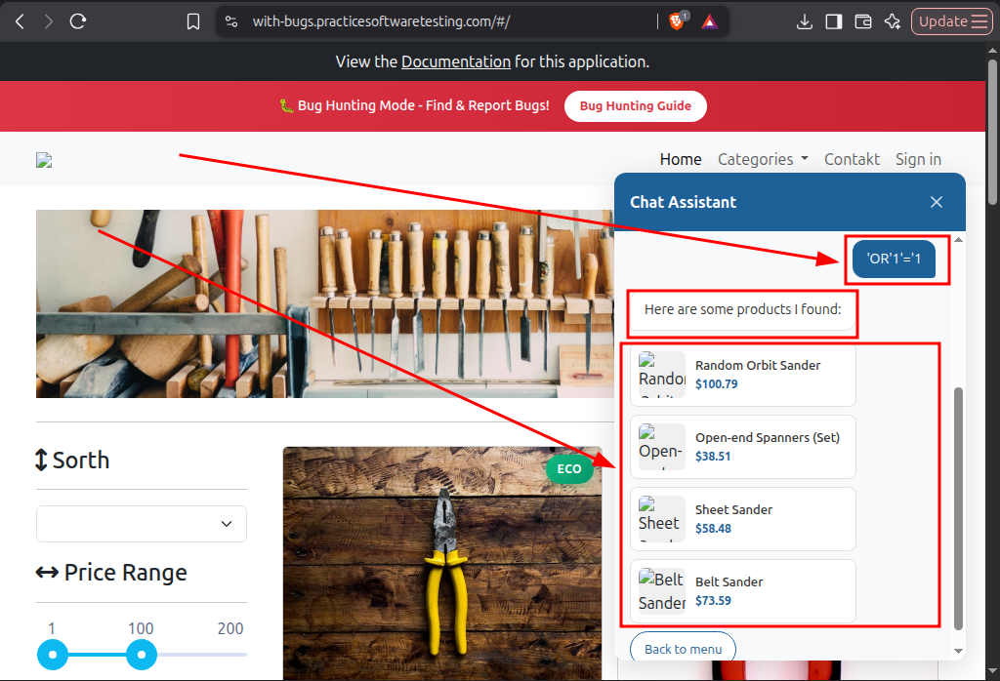
